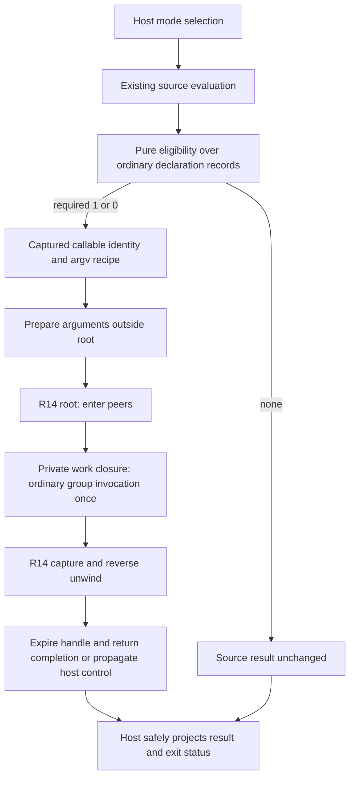

# Host-selected Application Lifecycle — companion design (Revision 2)

Status: **PROPOSED — NOT APPROVED — NOT IMPLEMENTED**.

Tracking: [#1271](https://github.com/m0smith/genia-2026/issues/1271).
Normative candidate: [contract](application-lifecycle-contract-DRAFT.md).
This companion records implementation mapping, classified illustrations,
compatibility evidence, decision cards, future R16/host validation, threats and
decomposition. **It defines no externally observable behavior.** Anything a user,
peer author, host embedder or reviewer can observe is normative in the contract;
this document only shows how it could be realized and tested. It does not
implement behavior, write RED tests, approve its own contract or modify Slice C.
Implementation release remains TBD; no R29 addition.

Revision 2 addresses technical-review findings B1–B5 (see the contract header).
Private carriers, journals and polling mechanisms below are **design choices, not
normative requirements**; a different realization that preserves the contract's
observables is conforming. No independent review of Revision 2 has occurred.

## 1. Evidence and current authority

Inspection baseline: `genia-2026@6d50a36d23cc4b894f0456ee502deb5d7796e99b`.
STATE §§1, 3, Program entrypoint convention, 9.7, 9.8 and 9.41 govern implemented
CLI, partial Model B, R8, R14 and MCP. RULES §18, REPL README Program entrypoint
behavior and README execution modes agree on main/1 > main/0 > source result.

Read [architecture report](https://github.com/m0smith/genia-2026/issues/1271#issuecomment-6326759433)
and [integration direction](https://github.com/m0smith/genia-2026/issues/1271#issuecomment-6326938758).
The latter approves contract drafting only and directs no duplicate #1226 note.
Approved Model B contract #1255 and design #1259 remain prospective where STATE
has not implemented them. [Slice C #1269](https://github.com/m0smith/genia-2026/issues/1269)
and draft [PR #1270](https://github.com/m0smith/genia-2026/pull/1270), inspected
read-only at `585f6aa229a55bbd3e3110c975dcaaa94a61e93e`, retain their separate U2
boundary and RED NO-GO. This draft does not disposition their stop conditions
for their current scope; it proposes the eventual separate entry integration.

Additional boundaries consulted: R14 contract; R8 STATE contract/coordinator;
MCP contract/threat model; execution-mode lifecycle proposal; execution-realization
and executable-semantic-conformance architecture; LLM contract; killer-workflow;
run-change and roadmap including R42. Proposed behavior is not implemented truth.

### Evidence locations

| Concern | Existing source / authority at baseline |
|---|---|
| Pure evaluation vs launcher | `src/genia/interpreter.py:run_source`, `_resolve_program_result`, `_run_execution_mode` |
| Entry/module ownership | `src/genia/environment.py:binding_owner`, `entry_scope`, `load_module` |
| Stored required arity, direct call | `src/genia/callable.py:GeniaFunctionGroup`, `get`, `__call__` |
| Ordinary-call propagation/TCO | `invoke_callable`, `eval_with_tco`, `GeniaFunction`, `_dispatch_open` |
| R14 core/known escape paths | `src/genia/lifecycle_runtime.py:_run_scope`, `_normalize_exception`, `_outcome_context` |
| Source lifecycle invocation | `src/genia/builtins.py` lifecycle_scope/child/repeat wrappers |
| R8 authority | STATE §9.7; `server_lifecycle.py`, `server_*_binding.py`, interpreter serve driver |
| Tests/discovery | `src/genia/test_cli.py:run_native_tests_from_file`, `discover_test_units` |
| MCP source-only boundary | `hosts/python/mcp_worker.py:execute_source`; STATE §9.41 |
| Portability applicability | `spec/manifest.json`, `spec/known_host_gaps.json`, existing R16 runner |

The prior report measured cleanup/expiry escapes on KeyboardInterrupt, invalid
enter/exit results and invalid err context, plus raw exception text in generic
lifecycle failure. Its 226 focused passes/five socket-permission failures are
historical investigation evidence, not this documentation PR's validation or
proof of application execution. No runtime suite or previous count is relabeled
as new implementation evidence.

## 2. Architecture and candidate implementation seam

Choose a thin host adapter, not a new lifecycle engine. Separate pure discovery
from argument execution and from scope ownership:



Candidate internal responsibilities (names descriptive, no API is introduced):

1. A pure entry-plan builder takes the resolved entry binding and reads declaration
   shapes. It returns no selection or callable identity/required arity/argument
   recipe/provenance. It must not call `.get(n)` and pick one of multiple records,
   invoke argv or use autoloading lookup to execute code during discovery.
2. Argument preparation preserves the existing environment argv binding call and
   raw value. It must not require a list when an explicit rebound callable returns
   another value. No scope owns effects from this phase.
3. The work closure closes over callable identity and argument vector; its R14
   handle is private. It invokes the existing **non-tail** ordinary call bridge,
   which must dispatch the whole group and normalize existing absence behavior.
   Internal recursion keeps the existing trampoline. A direct Python `group(*args)`
   is not automatically equivalent to `invoke_callable` and needs explicit review.
4. Existing root execution owns entry/unwind. No repeated engine or host-maintained
   parallel entered-peer list. Host peers are empty by default; an embedding may
   explicitly supply existing peer maps under its own authority.
5. Final projection unwraps only LifecycleResult.result, after terminal invalidation.
   Host output/control identity stays private. No new public result fields,
   automatic Outcome escalation or OS exit interpretation of returned numbers.

### Why an unchanged R14 is insufficient for the proposed guarantees

The baseline catches Exception but not KeyboardInterrupt; malformed returns and
outcome-context checks can escape before unwind/terminal lifetime assignment;
normalization uses str(error). An adapter over **unchanged** R14 cannot honestly
promise robust owned cleanup for those paths. Empty peers do not fix stale
handles or generic diagnostics, and enabling real peers would expose the gaps.

Propose bounded hardening in the **existing** engine, with a host control
bridge. The observables are in contract sections 6–8; the realization is:

- **One algorithm, two consumers.** The engine keeps its single enter/work/unwind
  algorithm. It gains an internal completion form that records, besides the
  closed LifecycleResult, any *raised-not-returned* occurrence (misuse or control)
  and nested observations. Two thin consumers read it:
  - the **public wrapper** (`lifecycle_scope`/`lifecycle_child`/`lifecycle_repeat`)
    returns the LifecycleResult for ordinary outcomes, and *re-raises* the
    original misuse error or control after unwind and invalidation (contract
    6.2). The public error type and message text are produced by the same code as
    today so identity is preserved;
  - the **application launcher** reads the completion record and projects it
    (contract 6.3). It never needs to re-raise because no application code runs
    between the scope's end and projection.
  No host-side parallel journal and no second unwind loop (contract 6.3, last
  paragraph).
- **Validation inside protected phase handling.** Descriptor validation stays
  before acquisition. Callback outcome checks move *inside* the per-callback
  guarded step: a malformed outcome sets the failure at that position, marks that
  peer not-owned (enter) or exit-attempted (exit), and falls into the existing
  unwind loop, then the wrapper re-raises the misuse. The `exit → some(value)`
  check compares to the contracted `"nil"`; this is the R3 change (valid-to-error
  for programs relying on the permissive acceptance).
- **Ownership commit.** Recording a peer in the owned list and publishing its
  context happen together in one engine-internal step with no callback between
  them (contract 7.4). The control bridge treats that step as non-deliverable.
- **Terminal invalidation.** Setting the terminal lifetime moves into an
  unconditional finalization of the scope operation (a `finally`-equivalent over
  recoverable paths) so no misuse, control or normalization failure leaves the
  handle readable.
- **Guarded normalization.** Projection of any failure never calls `str`/`repr`
  on the failure object. A raising `__str__` therefore cannot escape and skip
  exits; any failure inside projection yields `application-host-failure` at the
  original position.
- **Recognized control retained, not flattened.** The engine records the control's
  category privately and does not convert it to a value-level `err`. After local
  unwind it re-raises through the public wrapper so enclosing synchronous scopes
  unwind in turn (contract 7.3). A private nested-observation list travels with
  the propagating control (for example as attributes on the control object or a
  wrapper control type) so the top-level launcher can render inner F and K
  (worked trace, section 2a). Nothing here is a new public result field.
- **Python reference-host realization of delivery.** Do not blanket-catch
  `BaseException`. Enumerate recognized controls: `KeyboardInterrupt` maps to
  `interrupt`; no `cancel` bridge is installed in the first slice. `SystemExit`,
  `GeneratorExit` and fatal runtime conditions pass through untouched.
  Raw asynchronous `KeyboardInterrupt` can fire between a callback's return and
  the ownership commit, so two realizations are compared:

  | Option | Mechanism | Strength | Cost |
  |---|---|---|---|
  | A. Latch and poll (recommended) | Launcher installs a SIGINT handler that only sets a latch flag; the engine and invoker check the latch at the contract's safe delivery points and then raise the control there | The commit window cannot be hit asynchronously; second request is naturally latched (contract 7.5) | Work that never reaches a poll point is not promptly interruptible; needs a repeated-request forced-abort policy (contract 7.5) |
  | B. Asynchronous exception with narrowed guarantee | Leave default `KeyboardInterrupt`; catch it at callback boundaries | Smallest change | The commit window can leak a just-acquired resource; the contract then requires the host to document that it does not claim the full 7.2 guarantee |

  Option A is a design recommendation only; the contract accepts either as long as
  the commit-window statement is honest. Neither promises anything after SIGKILL,
  a crash, a fatal runtime condition, or a non-returning cleanup callback.
- **Alternative rejected:** a callback-normalizing invoker without engine changes
  is unacceptable if it reimplements journaling/unwind or bypasses the runtime's
  own late validation. This design does not authorize those changes now or any
  rewrite of R8's separate engine.

### 2a. Worked trace: ordinary failure then nested interruption

Illustrative host-level trace of contract 7.3 (classified: **proposed, not
executable today**; today the same program has no exits run and the handle left
readable). Outer scope O has one owned peer `p`. Its work calls a public inner
scope I with owned peer `q`. I's work raises ordinary failure F. I's `q.exit`
is then interrupted (K).

| Step | Scope | Event | Primary | Cleanup list | Handle |
|---|---|---|---|---|---|
| 1 | I | work raises F | F (work) | — | active |
| 2 | I | `q.exit` receives summary (error, work); K delivered | F (work) | [K at `q` exit] | exiting |
| 3 | I | no earlier owned peer remains; unwind done | F (work) | [K] | invalid; control re-raised, no LifecycleResult returned |
| 4 | O | K arrives in work | K (work) | — | active |
| 5 | O | `p.exit` receives summary (error, work, no peer), returns ok | K (work) | [] | exiting |
| 6 | O | unwind done | K (work) | [] | invalid; K re-raised to launcher |
| 7 | Host | projection | primary = interruption, status 130 | nested: I primary F (depth 1, work) | — |

Rendered shape (wording is part of D5, structure is contractual):

```text
Error: application-interrupted [work]
  nested[1]: <identity of F> [work]
  nested[1]: exit interrupted (this is the primary interruption)
```

Consequences to test later: F never becomes O's primary; the exit status is
130 because only O's primary decides it; `q`'s exit is not retried; `p` still
exits; both handles are expired; and K appears once as primary.

If instead O had an *earlier* failure (for example O's own `p.enter` failed, so
no work ran), O's primary stays that failure and status is 1; a control arriving
later in O's cleanup is a secondary observation.

### 2b. Diagnostic projection realization (contract 8.2)

Today `_normalize_exception` reads `str(error)`. The projection needs a
**structured supplier** at each raise site that is in the table: a small
internal diagnostic record (identity token, trusted fields) that the raising
code attaches to the error. The host reads only that record. Errors without it
fall to `application-host-failure`. Parsing existing message text to recover
fields (for example splitting `No matching case for function main/1 with
arguments [...]`) is **not** an allowed bridge, because it would reintroduce
untrusted text; the matching raise site is edited to supply callee/arity/location
and to omit arguments from the projected form (legacy change L1).

Consequence for scope: the first implementation slice would map only the
categories whose raise sites can supply structure cheaply (`no-matching-case`,
`undefined-name`, `call-shape`, `builtin-type`, lifecycle tokens, interruption,
output failure) and send everything else to the fixed host failure. This is a
visible usability reduction for unmapped errors, accepted under D5 until further
categories are added by later approval. The technical review's read-only probe (comment 6327388782) showed the hazard: an exception
whose `__str__` itself raises escapes the current normalizer and leaves exits
unrun; the guarded path above removes that class of failure.

## 3. Entry compatibility and migration evidence

### Required arity is not fixed arity

The legacy selector reads keys 1 then 0. A rest declaration stored at those keys
is selected. Preserve this policy structurally across future ordinary records:
fixed one-argument plus rest-one records may share eligibility, while ordinary
dispatch, not discovery, selects the effective stratum/candidate.

| Case | Baseline observation / future consequence |
|---|---|
| main/1 and main/0 | /1 selected, including empty argv list |
| main(args,..rest), CLI x | Receives `["x"]` as args and empty rest |
| main(..rest), CLI x | Invoked with no args; rest empty; no argv spread |
| Only required arity 2 plus final source value | No main call; source value retained |
| Lambda bound to main plus source value | No automatic entry |
| Immutable alias of ordinary group bound to main | Eligible today; immutability does not freeze group |
| Alias of imported ordinary group bound to main | Entry deliberately selects alias; original module closure retained |
| Grouped main/1 pattern miss with main/0 present | Existing failure, no fallback |
| Future ordinary pattern-only or mixed group | Required-arity selection, normal whole-group dispatch, not Slice C's current U2 workaround |

### Two additional effects of whole-group invocation

**Unified varargs:** baseline `main(..all)` plus `main(x,..rest)` selects key 1
and executes that record. Existing group invocation also finds its current exact
required-key entry. Under approved prospective Model B shape-stratum semantics,
with no fixed one-argument shape, minima 0 and 1 both admit the one-list call and
ordinary dispatch can be ambiguous. #1269's general D1 approval is not assumed
to approve this separate launcher integration. Contract D1 must acknowledge it.
No “choose min1 anyway” escape hatch in the launcher is proposed.

**Rebound argv/absence:** an additional baseline probe in this drafting session
ran existing APIs only (no test file/runtime change):

```genia
argv = () -> none("custom")
main(args) = 42
```

Classification: **implemented Python-host source at the inspected baseline**.
Current command launcher prints 42/exit 0, because it calls the selected
GeniaFunction directly. Calling the group through existing invoke_callable with
that argv return yields none("custom") through ordinary absence propagation.
That would change the future launcher result, even without pattern headers.
Contract D2 proposes ordinary call semantics, explicitly requiring approval.
Do not silently set a skip-propagation flag, coerce none to a list, or overwrite
argv to conceal the delta. A rebound argv returning scalar 9 is accepted today
and passes 9 to main; new string-list validation would be an additional break.

Capturing group identity before preparation preserves binding replacement
identity. It does not snapshot group contents; effects from permitted argv/peer
callbacks may change that same group's records before ordinary invocation. New
snapshot/atomic concurrency semantics would be another proposal, not a free
optimization. Preserve Model B alias/declaration-ownership and live-call rules.

## 4. Classified illustrations

### Existing ordinary entry (implemented Python host)

```genia
main(args) = args
```

File/command launcher already supplies argv as one argument. This example does
not prove an application scope exists today. Default host peers remain empty in
the proposal; the source gains no hidden-root context access.

### Ordinary pattern main (proposed, not executable merged behavior)

```genia
main([]) = "No arguments"
main(["help", ..rest]) = "Show help"
main(args) = process(args)
```

Classification: **future Model B plus separately approved application-entry
integration**. `process` is application-defined. Baseline parses/lowers the new
headers but evaluation rejects them with model-b-not-implemented. First-match
within the ordinary base unit, ordinary shape precedence, guard evaluation and
ambiguity belong to the dispatcher. No special main pattern language or implicit
cross-arity fallback. Closed main and linked views wait for their own milestones.

### Wrapper structure (proposed host pseudocode, not Genia source)

```text
run_result = evaluate_entry_using_existing_rules()
entry_plan = discover_without_invocation(entry_binding)
if no entry_plan:
    return existing_source_result_policy(run_result)
args = prepare_existing_argument_recipe(entry_plan)
completion = existing_R14_root(explicit_host_peers,
    work = ordinary_invoke(captured_group, args))
return host_project_after_unwind(completion)
```

The pseudocode hides neither a second unwind loop nor new source API. Scope root
handle is available to the private work closure, not to main. If root-child access
or injected config later becomes required, a separate explicit-context design
must demonstrate need; ambient lookup remains excluded.

### Killer-workflow proving composition (proposed scenario)

Use existing `examples/validated_pipeline_demo.genia` and
`examples/r14_repeated_record_lifecycle_proving_case.genia` as implemented
reference behavior. The proposed future launcher application consumes a bounded
messy record fixture, explicitly parses JSONL, validates/reshapes with existing
validate_each/collect_validated/Outcome helpers, and **returns** the accepted
records plus ordered diagnostics as one ordinary report value.

Output ownership in this scenario follows contract 8.3 (revised):

| Stream | Owner | What happens |
|---|---|---|
| Host final stdout/stderr | Host (borrowed) | Receives the returned report and any failure diagnostics **after** unwind. No peer holds or closes it |
| `rejects` sink (a file or sink for rejected-record lines) | A host-supplied embedding peer `rejects` | Opened in `rejects.enter`, written during work, flushed and closed in `rejects.exit` |
| Anything else the work opens | The work or a source scope | Closed by its own owner before the application scope ends |

An earlier draft of this scenario allowed "an actual output or diagnostic peer"
and left unclear whether that peer could be the stream the host later uses for
the final report. Closing a host final stream in `exit` would let R14 complete
with status ok and then fail the host's final emission (reproduced by the
technical review's composition probe). The revised scenario avoids that: the
report travels as a **returned value**, the `rejects` sink is a different
resource, and the host never writes to a peer-owned sink.

Successful main owns one `rejects` acquisition/close. An invalid record
represented by ordinary err contributes diagnostics without failing the root. A
thrown processing failure remains primary through failing cleanup. Bounded take
consumes only the needed records, closes element work and the outer owner.
Import/discovery acquires nothing automatically. No Genia API is invented to mint
the host resource, access a hidden provider, or replace Flow validation
transformations.

Final-emission failure after cleanup (contract 8.3 item 4) is tested separately:
cleanup succeeds, then stdout write fails; the host exits 1 with a best-effort
`application-output-failed` on stderr and does not re-enter the scope.

## 5. Threat model and maintainability review targets

| Threat / maintainability hazard | Required defense or explicit limit |
|---|---|
| Discovery executes guard/body/argv or autoload | Pure shape inspection only; spies in future host tests |
| Hidden setup during import/test/MCP | Mode-specific drivers unchanged; activation after eligible main only |
| Interrupt between enter success and ownership commit | Engine journal with safe control-delivery boundary; D4 platform decision |
| Invalid outcome or diagnostic stringification skips cleanup | Guard validation/normalization within one engine; fixed safe failure fallback |
| Host paths/addresses/protected contents leak | Explicit safe Genia diagnostic projection, opaque host reason, no raw result/context dump |
| Inner cancellation swallowed as ordinary child result | Private recognized-control propagation after local unwind; no magic value-level cancellation |
| Earlier failure replaced by cleanup/control | Existing primary order; ordered secondary observations, no generic finally overwrite |
| Broken pipe hides genuine cleanup failure | Separate quiet-output policy from internal primary order; contract D6 |
| Hidden root accidentally becomes global/DI container | Handle private; explicit context access and capabilities; empty default peers |
| Returned Flow/callback keeps expired resources | Synchronous scope lifetime; no implicit retain/adopt/materialize |
| Huge compatibility helper forks the dispatcher | One declaration-shape view, existing ordinary invocation and TCO; no clause selection |
| Host “supported” label hides C++ gaps | Case-level R16 evidence and issue-backed gap decision; unsupported is not PASS |
| Peer closes the stream the host needs for final output | Contract 8.3 item 1: non-closing views for host final streams; pre-emission writability check; report returned as a value |
| Malformed callback outcome returned as ignorable data | Contract 6.2: misuse is still raised, after cleanup and invalidation |
| Nested interruption swallowed by an inner scope | Contract 7.3: control re-raised after local unwind; exit status from the root's primary only |
| Caller arguments or paths in a generated diagnostic | Contract 8.2 projection table; trusted structured suppliers only; synthetic fixed fallback |
| Required CLI regression hidden behind an optional gap | Contract 11.1/11.6: required cases are not optional; merge blocked absent a separately authorized mechanism |

The source program can already perform explicit authorized effects during entry
initialization/preparation; the wrapper does not sandbox it or roll back output.
Context is read-only lookup, not a deep freeze of Ref/Cell/capabilities. Protected
carriers keep R10 sinks/declassification; plain secret strings are not made safe
by scope storage. Peers own their internal partial-acquisition compensation.

Review should inspect actual selectors, invokers, builtins and all affected R14
consumers. Engine hardening is not “just a CLI refactor.” It needs public misuse,
exception, nested control and finalization regression review. R8 must remain
separate; no opportunistic merge of lifecycle implementations.

## 6. Portability and applicability plan

The pre-flight record answers all seven fields: portable authority/observables,
existing IR/value boundary, executable evidence plan, applicability, host claims,
owned gaps and truth synchronization. This section corrects the Revision 1 plan,
which treated the optional known-gap path as able to cover required CLI cases. It
cannot (contract 11.6).

### 6.1 What the current R16 machinery actually does

| Fact | Source at baseline | Consequence |
|---|---|---|
| `cli_file_mode` and `cli_command_mode` are required capabilities | `spec/manifest.json` `required_capabilities` | Shared CLI cases without `requires:` are baseline required cases |
| The file-mode main case has no `requires:` | `spec/cli/file_mode_main_argv.yaml` | It is required; changing or failing it is a required-behavior event |
| Known-gap entries must name an optional capability | `load_known_gaps` rejects names outside `optional_capabilities` | A required case cannot be listed as a known gap |
| The gate compares only the optional set | `host_parity_gate.check_parity` iterates `optional_capabilities()` | A green gate says nothing about required cases |
| Unsupported is counted separately and is not in the failure-count veto fields | runner counts; `_FAILING_COUNT_FIELDS` | Unsupported is neither PASS nor failure; it must be read, never summed into PASS |

### 6.2 Applicability by area

| Area | Required or optional | Python | C++ | Evidence rule |
|---|---|---|---|---|
| Legacy main/argv/fallback (entry floor) | **Required** (`cli_file_mode`, `cli_command_mode`) | Implemented | Pinned evidence must be read per case; trailing-argument CLI is not evidenced | Existing shared cases must keep passing; no new tag |
| Diagnostic redaction for application-phase failures | Changes expected stderr of any required case that observes it | Implemented host change | Would require matching shared expectation | Counts as a required-expectation migration (contract 11.5) |
| Future ordinary pattern main | Needs the #1269 `default_open_functions` surface plus a CLI mode | Not at this baseline | Absent | Do not advertise now |
| Aliases/import ownership | Existing ordinary-call and `multi_file_eval` cases | Implemented | Bounded/unsupported modules | Reuse existing cases |
| Host-supplied peers, interruption mapping, final-stream lifetime | **No portable source observable exists** (default peers empty, no source API) | Host-local Python tests | Not applicable until a portable observable exists | Stays host-local; no capability advertised |
| Any genuinely portable lifecycle surface | Would be optional if independently claimable | — | — | Needs separate authorization to name a capability (D8) |

### 6.3 Gates (all blocking, none authorized here)

1. Required entry-floor cases pass on every host that claims the required CLI
   capabilities, or a **separately authorized** required-case exception/migration
   decision exists with owner, tracking issue, affected host, exact cases,
   reason and removal condition. No such mechanism exists today; this design does
   not create it.
2. Any change to an existing required expectation is made as a shared change
   first, then implemented by both hosts, or covered by item 1.
3. Pass, unsupported and failure counts are reported separately. Unsupported is
   never PASS and is never described as "parity".
4. An optional lifecycle capability is introduced only if a portable observable
   exists and its name is separately authorized; it then needs the existing
   issue-backed gap entry for any host that lacks it.

Source inspection of `genia-cpp@44456baea06b4bb7bdf727e39939dd7150261ee6` showed
adapter CLI → engine evaluation without Python-style main orchestration; STATE
already limits C++ argv to pipe mode. Prior prebuilt smoke observations were
supplementary, not a certified source build. C++ R14/config/protected/MCP,
ordinary Model B and TCO remain unproved/unsupported as scoped in authorities.
Existing historical R24–R27 zero-failure counts are not evidence for this feature.

Do not create a new protocol, registry, profile or "application_supported" flag.
No gap/manifest edits are made in this proposal-only PR.

## 7. Future validation plan — not RED authorization

No executable test/spec is added here. After contract decisions and independent
design gate, record concrete R16 RED cases and host tests on their own TEST commit.

| Future gate | Proposed observations / adversarial cases | Placement |
|---|---|---|
| Entry floor | Both arities, empty/option argv, no main, only required arity 2, rest keys 0/1/2, lambda/noncallable, immutable/imported group alias | Shared CLI; pure-query host tests |
| Whole-group migration | Mixed legacy/pattern, fixed/rest same minimum, differing rest minima, no-match with main/0, first-match and guard once | Shared CLI/eval under implemented Model B applicability |
| Argument compatibility | Rebound argv effects once, scalar/none returns, failure before root, main binding replacement vs same-identity mutation | Shared where expressible; private host mutation characterization |
| Resource lifetime | Empty peers, ordered enters/reverse exits, partial entry, work throw vs returned err, retained result after exit failure, expired handle | Shared ordinary lifecycle observations; host-owned peer injection |
| Malformed callbacks | Integer/none/out-of-contract some exit, bad err context/reason, exception while normalizing, failed exit still permits earlier exits | Shared portable misuse after chosen D3 policy; host adversarial objects |
| Control | Keyboard/cooperative delivery at enter/work/exit and journal boundary; nested scopes; cleanup fails during interruption; second request/forced kill limits | Host tests with injected controls/barriers and allowed OS subprocess signals |
| Security/output | Host sentinel/path/address non-leakage, protected carriers, safe legacy diagnostic identity, broken pipe plus cleanup, failed final rendering/stderr | Shared safe-value cases; Python host sinks and exception normalization |
| Modes | Import/parse/discovery no automatic root; explicit top-level effects still run; pipe no-over-pull, REPL recovery, native report, R8 listener, MCP no main/kill-reap | Existing shared CLI/module observations and focused host suites |
| Portability | Exact case applicability, both host revisions, pass/unsupported/failure counts and owned gaps | Existing R16 runner/comparator/protocol/parity evidence |
| Public misuse (B1) | Malformed enter and malformed exit each still **raise** from public lifecycle_scope/child/repeat; earlier owned peers exited in reverse order first; handle expired; `exit → some(99)` newly raises; a returned work `err` is data; main running a public scope with malformed enter then returning 42 still exits 1 | Host-local Python tests (no portable observable for peers) |
| Nested interruption (B2) | The worked trace in section 2a; interruption in enter, work, exit; commit-window behavior per chosen realization; second request latched; no cleanup claim after kill; status from root primary | Host tests with injected controls and barriers; allowed OS subprocess signals |
| Diagnostic projection (B3) | One sentinel per redaction class (argument, path, address, protected value, peer context, exception text); a failure whose `__str__` raises; projection failure still runs every exit and expires the handle; each table identity | Host tests for sentinel absence; shared CLI cases only where a required expectation is touched |
| Final streams (B4) | A peer attempting to close a host final stream; closed stream detected before emission; stdout failure after clean cleanup (exit 1, no re-entry); stderr failure; quiet broken pipe unchanged | Host-local Python tests |
| Required CLI (B5) | Full pinned run of the existing required CLI cases on each host with counts reported separately | Existing R16 runner and comparator

Shared CLI/error observations are stdout/stderr/status; no invented structured
error assertion framework. Direct-IR twins stay host-local where protocol only
takes source. Python tests are not the sole portable authority when shared
observations can express behavior. Use native Genia only where appropriate and
label Python-host-only native execution honestly.

Future GREEN must reference failing-test SHA, followed by maintainability review,
truth sync, independent behavioral/doc audit and distillation. Run relevant
socket cases where permitted; do not relabel permission errors skips or claim
full regression from a sandbox-safe partition.

## 8. Small independently reviewable sequence

These are proposed boundaries, not created issues or authorizations:

1. **Contract/design decision closure:** exact-head review by a reviewer who is
   neither the author of this draft nor of its technical review, then maintainer
   decisions D1–D8; reconcile existing R14 amendments and host scope. The required
   CLI gate (contract 11.6) is resolved here or recorded as blocking.
2. **R14 robustness prerequisite:** its own RED -> GREEN -> review -> truth/audit
   gate for protected unwind, malformed outcomes, safe diagnostics and bounded
   control propagation in the same engine. No launcher rewrite or R8 rewire.
3. **Default launcher integration:** separate RED -> GREEN gate after relevant
   Model B local execution is verified, pure eligibility/argv recipe/one ordinary
   invocation and host projection. Include required legacy compatibility oracles
   and explicitly approved deltas; empty default peers, other modes unchanged.
4. **Optional later consumers:** linked/closed entry after their own milestones,
   user-facing ergonomics only if scheduled, persistent sessions under R42,
   portable resource realization where R35 is relevant. No ticket stack now.

Full Model B linking/closed implementation need not block a local-only contract.
Slice C's U2 workaround and its review are not changed or blocked by this draft.
No step is silently assigned to R29/R33/R35/R42 or a new numbered release.

## 9. Documentation impact and publication gate

This PR adds only the proposed contract, this companion and a process pre-flight
under `.genia/process/`. Implemented STATE/RULES/REPL README/README, LLM contract,
R8/R14 docs, specs/tests, registry/generated MCP profile, host claims and roadmap
remain unchanged. Existing exact SHA is the baseline, not a claim the proposal
executes there. No spec or runnable proposal is added to authoritative surfaces.

After future verified behavior: update all core truth surfaces, relevant book,
cheatsheets/examples, semantic facts and scoped MCP profile with STATE anchors,
host capability/gap/evidence and release/roadmap documentation. genia_run must
still use source evaluation, not the CLI application's main dispatch.

Focused validation for this documentation PR: existing semantic/state/lifecycle
truth tests, generated MCP-profile check, staged strict MkDocs, link and diff
checks. Results belong in the PR/issue handoff, not fabricated as behavioral proof.
No new tests, full runtime regression, parity certification or independent review
is claimed by writing these documents.

Next gate: **exact-head review of the Revision 2 head by a genuinely different
reviewer**, then maintainer D1–D8 decisions. The Revision 1 technical review was
written by the original author of the draft and does not satisfy the
author-independent requirement; repeated self-review is not independent approval.
If no distinct reviewer is available, the gate remains unmet. Stop after
documentation publication; no RED, implementation, merge, release assignment or
duplicate dogfooding note.

Eventual implementation must synchronize `GENIA_STATE.md`, `GENIA_RULES.md`,
`GENIA_REPL_README.md` and `README.md`, the semantic facts and MCP language
profile, host documentation, applicable release/roadmap material and executable
evidence. None of these is touched by this PR.

## 10. Decision cards D1–D8

Each card expands the matching row of the contract's decision register (its last numbered part) with one small example.
Examples are classified: **current** = observed at the inspection baseline in the
technical review's read-only probes (existing APIs, not a prototype of the
launcher); **proposed** = not implemented and not approved. Recommendations are
advisory and are **not approvals**. "Needed before" names the earliest gate that
must see an explicit maintainer answer.

### D1 — Required-arity selection and whole-group invocation

- **Question.** May the launcher pick main by structural required arity and call
  the whole ordinary group once, instead of calling one internal arity record?
- **Current.** The launcher reads key 1 then key 0 of the group and calls that
  record directly. A rest record stored at key 1 or 0 is selected.
- **Proposed.** Structural eligibility (required arity 1, else 0, else source
  result), then one ordinary invocation of the whole group.
- **Example (current vs proposed).**

  ```genia
  main(..a) = "zero"
  main(x, ..r) = "one"
  ```

  With a trailing argument, current: `"one"` (key-1 record). Proposed: ordinary
  dispatch sees minima 0 and 1 both admit one list argument and reports the
  ordinary varargs ambiguity (the implemented explicit-`open` analogue raises
  `OpenFunctionVarargsAmbiguityError`). Whether an ordinary, non-open group
  behaves identically depends on the unmerged Model B work and must be confirmed
  at integration.
- **Compatibility.** Valid-to-error for varargs groups of this shape. Pattern-only
  and mixed groups become newly eligible (new behavior, not a break). #1269's
  generic D1 approval is not launcher-integration approval; Slice C's U2 is
  untouched.
- **Recommendation.** Approve the principle and the disclosed varargs change.
- **Needed before.** Contract acceptance; integration RED.

### D2 — Rebound argv and live callable identity

- **Question.** Keep calling a rebound `argv()` once, outside the scope, and keep
  main's identity live, accepting ordinary absence propagation?
- **Current.** Rebound argv is called; its return is passed as the one argument
  with no coercion; the selected record is called directly, so an absent argv
  return does not stop main.
- **Proposed.** Capture identity before argv; call argv once outside the scope;
  invoke the group through the ordinary call bridge.
- **Example.**

  ```genia
  argv = () -> nil
  main(a) = 42
  ```

  Current: `42`, exit 0. Proposed: the ordinary call propagates absence, so the
  program yields a nil-like absence and nothing is echoed (exit 0). With
  `none("custom")` the absence value is returned instead of 42.
- **Compatibility.** Result changes for programs that rebound argv to an absence
  value. Scalar argv (`argv = () -> 9`) is unchanged. No coercion, string-list
  validation, snapshot or skip-propagation flag is proposed.
- **Recommendation.** Approve, acknowledging the absence change.
- **Needed before.** Contract acceptance; integration RED.

### D3 — Misuse: public raise versus private projection; `exit → some(99)`

- **Question.** Do public `lifecycle_scope`/`child`/`repeat` keep raising on a
  malformed callback outcome (now after cleanup), and is `exit → some(non-"nil")`
  newly rejected?
- **Current.** Malformed enter/exit outcomes raise at once: earlier owned exits do
  not run and the handle stays readable. An exit returning `some(99)` is accepted
  as success.
- **Proposed.** Keep raising, but exit earlier owned peers and invalidate first;
  the application root projects the same occurrence privately; newly reject
  `some(non-"nil")`.
- **Example.**

  Pseudocode (not Genia source): `main(args)` runs a public `lifecycle_scope`
  whose second peer's `enter` returns the integer 9 (malformed), ignores the
  scope operation's result, and then returns 42.

  Current: the error escapes, exit 1. Proposed: exit 1 as well (earlier peers
  exit first). Returning a failed result instead would make the program return
  42 and exit 0, which is why a return is rejected. A peer whose exit returns
  `some(99)` is status ok today; proposed, it raises.
- **Compatibility.** R1–R4 in contract 6.4; some(99) is valid-to-error.
- **Recommendation.** Approve raise-after-cleanup; approve R3 only with explicit
  acknowledgement; option (b) (keep permissive) is a legitimate alternative.
- **Needed before.** Contract acceptance; R14-hardening RED.

### D4 — Bounded interruption and nested projection

- **Question.** Which interruptions are recoverable, what does cleanup guarantee,
  and how are nested failures reported?
- **Current.** A keyboard interrupt in work skips all exits and leaves the handle
  active; the launcher does not catch it.
- **Proposed.** Contract section 7: closed control set (`interrupt`; `cancel`
  only with a documented bridge), safe delivery points, commit-window honesty,
  latch for repeated requests, root-primary status, chronological nested
  secondary diagnostics. No promise after SIGKILL, crash, fatal conditions or
  non-returning cleanup.
- **Example.** Section 2a: inner F then interrupted inner exit K → outer primary
  K, status 130, F reported as a nested observation.
- **Compatibility.** Exits that were skipped now run (R4); a new 130/1 mapping.
- **Recommendation.** Approve the bounded section 7; choose latch-and-poll or
  document the narrowed commit-window guarantee (section 2); defer async
  cancellation, public tokens and a broader signal set.
- **Needed before.** Contract acceptance; R14-hardening RED.

### D5 — Safe diagnostic projection

- **Question.** Is the contract 8.2 projection table, with a fixed host-failure
  fallback, an accepted compatibility change?
- **Current.** Failures print exception text, including caller arguments for a
  grouped miss; file-mode locations may carry an absolute path.
- **Proposed.** Structured, token-based projection; redaction classes; L1–L4
  changes; L5 unchanged.
- **Example (illustrative wording).** Current:
  `Error: No matching case for function main/1 with arguments [["SYNTHETIC_ARG"]]`.
  Proposed: `Error: no-matching-case main/1 [work]` plus a logical location. The
  argument value never appears.
- **Compatibility.** Argument and path redaction; unmapped categories show only
  `application-host-failure` until added.
- **Recommendation.** Approve the table and L1–L5; extend categories only by
  later approval.
- **Needed before.** Contract acceptance; implementation RED.

### D6 — First-primary, quiet broken pipe, and final-stream ownership

- **Question.** Keep first-primary ordering and quiet broken pipe, and make host
  final streams non-closable by peers?
- **Current.** Quiet broken pipe exits 0; no application scope exists.
- **Proposed.** First-primary preserved; quiet pipe alone still 0; a genuine
  cleanup failure is visible and exits 1; host final streams outlive unwind and
  cannot be closed by peers; failed final emission after cleanup does not
  re-enter the scope.
- **Example.** A peer's `exit` closes the stream the host will print the report
  to: R14 reports status ok, then final emission would fail. Proposed: the peer
  receives only a non-closing view and the close fails as an exit failure; the
  report is returned as a value and printed by the host.
- **Compatibility.** Cleanup failure after a quiet pipe changes from silent 0 to
  visible 1.
- **Recommendation.** Approve with contract 8.3.
- **Needed before.** Contract acceptance; implementation RED.

### D7 — Thin adapter, no new surface

- **Question.** Is the first slice a thin host adapter over R14 with empty default
  peers and no source API or ambient scope?
- **Current.** There is no application scope.
- **Proposed.** Thin adapter; empty default peers; main gets no hidden-root
  access; initialization and argument preparation outside the scope; REPL, pipe,
  test, serve and MCP unchanged.
- **Example.** `main(args) = args` behaves as today except for diagnostics and
  status of failures; nothing is injected into it.
- **Compatibility.** None for valid programs.
- **Recommendation.** Approve.
- **Needed before.** Contract acceptance.

### D8 — R16 applicability and host gaps

- **Question.** How are required CLI cases protected while lifecycle behavior is
  added Python-first?
- **Current.** Known-gap entries may name only optional capabilities; the gate
  compares only the optional set; no required-case exception mechanism exists.
- **Proposed.** Contract 11: required CLI cases stay required; lifecycle host
  behavior stays host-local unless a portable observable is separately
  authorized; merge blocked until a required-case path is separately authorized.
- **Example.** The existing `file_mode_main_argv` case has no `requires:`. A
  known-gap entry for it would be rejected by the loader; relabeling it optional
  would hide a required regression.
- **Compatibility.** None for programs; process-only.
- **Recommendation.** Approve the separation; authorize no exception now.
- **Needed before.** RED and merge.
