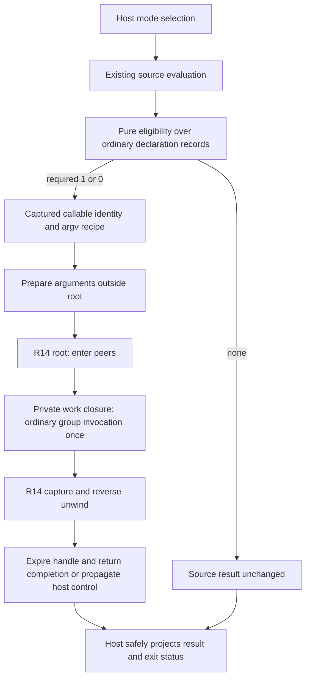

# Host-selected Application Lifecycle — companion design

Status: **PROPOSED — NOT APPROVED — NOT IMPLEMENTED**.

Tracking: [#1271](https://github.com/m0smith/genia-2026/issues/1271).
Normative candidate: [contract](application-lifecycle-contract-DRAFT.md).
This companion records implementation mapping, classified illustrations,
compatibility evidence, future R16/host validation, threats and decomposition.
It does not implement behavior, write RED tests, approve its own contract or
modify Slice C. Implementation release remains TBD; no R29 addition.

## 1. Evidence and current authority

Inspection baseline: `genia-2026@6d50a36d23cc4b894f0456ee502deb5d7796e99b`.
STATE §§1, 3, Program entrypoint convention, 9.7, 9.8 and 9.41 govern implemented
CLI, partial Model B, R8, R14 and MCP. RULES §18, REPL README Program entrypoint
behavior and README execution modes agree on main/1 > main/0 > source result.

Read [architecture report](https://github.com/m0smith/genia-2026/issues/1271#issuecomment-6326759433)
and [integration direction](https://github.com/m0smith/genia-2026/issues/1271#issuecomment-6326938758).
The latter approves contract drafting only and directs no duplicate #1226 note.
Approved Model B contract #1255 and design #1259 remain prospective where STATE
has not implemented them. [Slice C #1269](https://github.com/m0smith/genia-2026/issues/1269)
and draft [PR #1270](https://github.com/m0smith/genia-2026/pull/1270), inspected
read-only at `585f6aa229a55bbd3e3110c975dcaaa94a61e93e`, retain their separate U2
boundary and RED NO-GO. This draft does not disposition their stop conditions
for their current scope; it proposes the eventual separate entry integration.

Additional boundaries consulted: R14 contract; R8 STATE contract/coordinator;
MCP contract/threat model; execution-mode lifecycle proposal; execution-realization
and executable-semantic-conformance architecture; LLM contract; killer-workflow;
run-change and roadmap including R42. Proposed behavior is not implemented truth.

### Evidence locations

| Concern | Existing source / authority at baseline |
|---|---|
| Pure evaluation vs launcher | `src/genia/interpreter.py:run_source`, `_resolve_program_result`, `_run_execution_mode` |
| Entry/module ownership | `src/genia/environment.py:binding_owner`, `entry_scope`, `load_module` |
| Stored required arity, direct call | `src/genia/callable.py:GeniaFunctionGroup`, `get`, `__call__` |
| Ordinary-call propagation/TCO | `invoke_callable`, `eval_with_tco`, `GeniaFunction`, `_dispatch_open` |
| R14 core/known escape paths | `src/genia/lifecycle_runtime.py:_run_scope`, `_normalize_exception`, `_outcome_context` |
| Source lifecycle invocation | `src/genia/builtins.py` lifecycle_scope/child/repeat wrappers |
| R8 authority | STATE §9.7; `server_lifecycle.py`, `server_*_binding.py`, interpreter serve driver |
| Tests/discovery | `src/genia/test_cli.py:run_native_tests_from_file`, `discover_test_units` |
| MCP source-only boundary | `hosts/python/mcp_worker.py:execute_source`; STATE §9.41 |
| Portability applicability | `spec/manifest.json`, `spec/known_host_gaps.json`, existing R16 runner |

The prior report measured cleanup/expiry escapes on KeyboardInterrupt, invalid
enter/exit results and invalid err context, plus raw exception text in generic
lifecycle failure. Its 226 focused passes/five socket-permission failures are
historical investigation evidence, not this documentation PR's validation or
proof of application execution. No runtime suite or previous count is relabeled
as new implementation evidence.

## 2. Architecture and candidate implementation seam

Choose a thin host adapter, not a new lifecycle engine. Separate pure discovery
from argument execution and from scope ownership:



Candidate internal responsibilities (names descriptive, no API is introduced):

1. A pure entry-plan builder takes the resolved entry binding and reads declaration
   shapes. It returns no selection or callable identity/required arity/argument
   recipe/provenance. It must not call `.get(n)` and pick one of multiple records,
   invoke argv or use autoloading lookup to execute code during discovery.
2. Argument preparation preserves the existing environment argv binding call and
   raw value. It must not require a list when an explicit rebound callable returns
   another value. No scope owns effects from this phase.
3. The work closure closes over callable identity and argument vector; its R14
   handle is private. It invokes the existing **non-tail** ordinary call bridge,
   which must dispatch the whole group and normalize existing absence behavior.
   Internal recursion keeps the existing trampoline. A direct Python `group(*args)`
   is not automatically equivalent to `invoke_callable` and needs explicit review.
4. Existing root execution owns entry/unwind. No repeated engine or host-maintained
   parallel entered-peer list. Host peers are empty by default; an embedding may
   explicitly supply existing peer maps under its own authority.
5. Final projection unwraps only LifecycleResult.result, after terminal invalidation.
   Host output/control identity stays private. No new public result fields,
   automatic Outcome escalation or OS exit interpretation of returned numbers.

### Why an unchanged R14 is insufficient for the proposed guarantees

The baseline catches Exception but not KeyboardInterrupt; malformed returns and
outcome-context checks can escape before unwind/terminal lifetime assignment;
normalization uses str(error). An adapter over **unchanged** R14 cannot honestly
promise robust owned cleanup for those paths. Empty peers do not fix stale
handles or generic diagnostics, and enabling real peers would expose the gaps.

Propose bounded hardening in the **existing** engine, with a host control bridge:

- Descriptor validation before acquisition; validate callback outcomes within
  protected phase handling. Treat protocol misuse as its own fixed failure,
  distinct from returned work err. If the callback's result violates the protocol,
  remaining owned exits still get their opportunity.
- One engine-owned acquisition journal and one unwind loop. Commit valid successful
  enter/context publication consistently before accepting the next recoverable
  cancellation. Do not create a second host-side resource journal to compensate.
- Terminal handle invalidation in an unconditional recoverable-finalization path;
  safe exception normalization must itself be guarded and non-effectful.
- Recognized host controls are retained privately, not flattened into arbitrary
  value-level err. After local unwind/invalidation, propagate a recognized control
  through synchronously enclosing scopes so they unwind too. Otherwise an inner
  scope could swallow Ctrl-C as ordinary data and outer main would continue.
- A private completion/control carrier may retain the local existing LifecycleResult
  for the host while re-propagating original control. It is not source-visible,
  not a new public result variant and not an ambient control context. Inner scope
  cleanup observations are retained privately with safe scope provenance for host
  reporting; each public LifecycleResult keeps only its own scope's cleanup list.
  Report nested cleanup in actual inner-to-outer unwind order. An earlier ordinary
  primary within the same scope remains primary if its cleanup observes
  interruption. A parent with no earlier failure records the propagated control
  at its own callback position; child ordinary failures are not implicitly
  promoted. Safe nested diagnostic observations preserve those distinct scopes.
- D4 must approve the exact shared-engine/public-wrapper admission and propagation
  seam before tests. Existing R14 public callers must not silently lose their
  established misuse identity or acquire a new cancellation API. A private engine
  completion path can preserve public re-raise policy after cleanup while allowing
  the application adapter's safe result projection. This proposal is a design
  obligation, not a claim that a public API already supports such a carrier.

**Python reference-host realization:** do not blanket catch BaseException and
pretend all conditions recover. Distinguish keyboard/cooperative controls from
SystemExit, GeneratorExit, fatal allocation/runtime conditions and forced kills.
A Python control bridge must enumerate delivery, deferral and supported platform
behavior. Raw asynchronous KeyboardInterrupt can arrive between callback return
and ownership bookkeeping; merely adding an except clause is insufficient.
The design must establish safe delivery/short noninterruptible ownership-commit
boundaries or explicitly narrow its guarantee. A caught control during callback
entry does not make unpublished resources owned. Host callbacks still compensate
partial acquisition themselves. No guarantee against a second uncontrolled
signal or non-returning exit callback is made.

A callback-normalizing invoker alone is an alternative, but becomes unacceptable
if it reimplements journaling/unwind or bypasses the runtime's own late validation.
D4 therefore prefers focused engine hardening plus explicit host control identity;
it does **not** authorize those changes now or rewrite R8's separate engine.

## 3. Entry compatibility and migration evidence

### Required arity is not fixed arity

The legacy selector reads keys 1 then 0. A rest declaration stored at those keys
is selected. Preserve this policy structurally across future ordinary records:
fixed one-argument plus rest-one records may share eligibility, while ordinary
dispatch, not discovery, selects the effective stratum/candidate.

| Case | Baseline observation / future consequence |
|---|---|
| main/1 and main/0 | /1 selected, including empty argv list |
| main(args,..rest), CLI x | Receives `["x"]` as args and empty rest |
| main(..rest), CLI x | Invoked with no args; rest empty; no argv spread |
| Only required arity 2 plus final source value | No main call; source value retained |
| Lambda bound to main plus source value | No automatic entry |
| Immutable alias of ordinary group bound to main | Eligible today; immutability does not freeze group |
| Alias of imported ordinary group bound to main | Entry deliberately selects alias; original module closure retained |
| Grouped main/1 pattern miss with main/0 present | Existing failure, no fallback |
| Future ordinary pattern-only or mixed group | Required-arity selection, normal whole-group dispatch, not Slice C's current U2 workaround |

### Two additional effects of whole-group invocation

**Unified varargs:** baseline `main(..all)` plus `main(x,..rest)` selects key 1
and executes that record. Existing group invocation also finds its current exact
required-key entry. Under approved prospective Model B shape-stratum semantics,
with no fixed one-argument shape, minima 0 and 1 both admit the one-list call and
ordinary dispatch can be ambiguous. #1269's general D1 approval is not assumed
to approve this separate launcher integration. Contract D1 must acknowledge it.
No “choose min1 anyway” escape hatch in the launcher is proposed.

**Rebound argv/absence:** an additional baseline probe in this drafting session
ran existing APIs only (no test file/runtime change):

```genia
argv = () -> none("custom")
main(args) = 42
```

Classification: **implemented Python-host source at the inspected baseline**.
Current command launcher prints 42/exit 0, because it calls the selected
GeniaFunction directly. Calling the group through existing invoke_callable with
that argv return yields none("custom") through ordinary absence propagation.
That would change the future launcher result, even without pattern headers.
Contract D2 proposes ordinary call semantics, explicitly requiring approval.
Do not silently set a skip-propagation flag, coerce none to a list, or overwrite
argv to conceal the delta. A rebound argv returning scalar 9 is accepted today
and passes 9 to main; new string-list validation would be an additional break.

Capturing group identity before preparation preserves binding replacement
identity. It does not snapshot group contents; effects from permitted argv/peer
callbacks may change that same group's records before ordinary invocation. New
snapshot/atomic concurrency semantics would be another proposal, not a free
optimization. Preserve Model B alias/declaration-ownership and live-call rules.

## 4. Classified illustrations

### Existing ordinary entry (implemented Python host)

```genia
main(args) = args
```

File/command launcher already supplies argv as one argument. This example does
not prove an application scope exists today. Default host peers remain empty in
the proposal; the source gains no hidden-root context access.

### Ordinary pattern main (proposed, not executable merged behavior)

```genia
main([]) = "No arguments"
main(["help", ..rest]) = "Show help"
main(args) = process(args)
```

Classification: **future Model B plus separately approved application-entry
integration**. `process` is application-defined. Baseline parses/lowers the new
headers but evaluation rejects them with model-b-not-implemented. First-match
within the ordinary base unit, ordinary shape precedence, guard evaluation and
ambiguity belong to the dispatcher. No special main pattern language or implicit
cross-arity fallback. Closed main and linked views wait for their own milestones.

### Wrapper structure (proposed host pseudocode, not Genia source)

```text
run_result = evaluate_entry_using_existing_rules()
entry_plan = discover_without_invocation(entry_binding)
if no entry_plan:
    return existing_source_result_policy(run_result)
args = prepare_existing_argument_recipe(entry_plan)
completion = existing_R14_root(explicit_host_peers,
    work = ordinary_invoke(captured_group, args))
return host_project_after_unwind(completion)
```

The pseudocode hides neither a second unwind loop nor new source API. Scope root
handle is available to the private work closure, not to main. If root-child access
or injected config later becomes required, a separate explicit-context design
must demonstrate need; ambient lookup remains excluded.

### Killer-workflow proving composition (proposed scenario)

Use existing `examples/validated_pipeline_demo.genia` and
`examples/r14_repeated_record_lifecycle_proving_case.genia` as implemented
reference behavior. Proposed future launcher application consumes a bounded messy
record fixture, explicitly parses JSONL, validates/reshapes with existing
validate_each/collect_validated/Outcome helpers, and returns accepted records
plus ordered diagnostics. A host test embedding supplies one actual output or
diagnostic peer; per-record concerns remain explicit source lifecycle peers.

Successful main owns one host acquisition/close. An invalid record represented
by ordinary err contributes diagnostics without failing root. A thrown processing
failure remains primary through failing cleanup. Bounded take consumes only the
needed records, closes element work and outer owner. Import/discovery acquires
nothing automatically. No Genia API is invented to mint the host resource,
access a hidden provider, or replace Flow validation transformations.

## 5. Threat model and maintainability review targets

| Threat / maintainability hazard | Required defense or explicit limit |
|---|---|
| Discovery executes guard/body/argv or autoload | Pure shape inspection only; spies in future host tests |
| Hidden setup during import/test/MCP | Mode-specific drivers unchanged; activation after eligible main only |
| Interrupt between enter success and ownership commit | Engine journal with safe control-delivery boundary; D4 platform decision |
| Invalid outcome or diagnostic stringification skips cleanup | Guard validation/normalization within one engine; fixed safe failure fallback |
| Host paths/addresses/protected contents leak | Explicit safe Genia diagnostic projection, opaque host reason, no raw result/context dump |
| Inner cancellation swallowed as ordinary child result | Private recognized-control propagation after local unwind; no magic value-level cancellation |
| Earlier failure replaced by cleanup/control | Existing primary order; ordered secondary observations, no generic finally overwrite |
| Broken pipe hides genuine cleanup failure | Separate quiet-output policy from internal primary order; contract D6 |
| Hidden root accidentally becomes global/DI container | Handle private; explicit context access and capabilities; empty default peers |
| Returned Flow/callback keeps expired resources | Synchronous scope lifetime; no implicit retain/adopt/materialize |
| Huge compatibility helper forks the dispatcher | One declaration-shape view, existing ordinary invocation and TCO; no clause selection |
| Host “supported” label hides C++ gaps | Case-level R16 evidence and issue-backed gap decision; unsupported is not PASS |

The source program can already perform explicit authorized effects during entry
initialization/preparation; the wrapper does not sandbox it or roll back output.
Context is read-only lookup, not a deep freeze of Ref/Cell/capabilities. Protected
carriers keep R10 sinks/declassification; plain secret strings are not made safe
by scope storage. Peers own their internal partial-acquisition compensation.

Review should inspect actual selectors, invokers, builtins and all affected R14
consumers. Engine hardening is not “just a CLI refactor.” It needs public misuse,
exception, nested control and finalization regression review. R8 must remain
separate; no opportunistic merge of lifecycle implementations.

## 6. Portability and applicability plan

The pre-flight record answers all seven fields before drafting: portable
authority/observables, existing IR/value boundary, executable evidence plan,
applicability, host claims, owned gaps and truth synchronization.

| Area | Existing R16 applicability / future evidence | Host boundary |
|---|---|---|
| Legacy main/argv/fallback | cli_file_mode, cli_command_mode; shared CLI stdout/stderr/status | C++ baseline lacks evidenced entry parity/file argv; do not mask under new optional tag |
| Future ordinary pattern main | Future #1269 default_open_functions surface plus relevant CLI mode | Capability absent at this baseline; do not advertise now |
| Aliases/import ownership | Existing ordinary call cases; multi_file_eval where modules used | C++ module support remains bounded/unsupported |
| R14 values/order/cleanup | Existing eval/error categories, resource/config capabilities only when actually used | No standalone lifecycle tag exists; D8 must settle gap representation before RED |
| Pipe/REPL/test/serve/MCP isolation | Existing capability-gated cases; Python-specific tests where no portable boundary | R8/MCP/native tests do not acquire C++ parity by association |
| Signals and Python invoker mechanics | Host tests, deterministic injected controls and subprocess signal observations | OS mechanics/status mappings are host-local; portable primary/lifetime policy shared |

Source inspection of `genia-cpp@44456baea06b4bb7bdf727e39939dd7150261ee6`
showed adapter CLI -> engine evaluation without Python-style main orchestration;
STATE already limits C++ argv to pipe mode. Prior prebuilt smoke observations
were supplementary, not a certified source build. C++ R14/config/protected/MCP,
ordinary Model B and TCO remain unproved/unsupported as scoped in authorities.
Existing historical R24–R27 zero-failure counts are not evidence for this feature.

Do not create a new protocol, registry, profile or “application_supported” flag
to avoid mandatory CLI regressions. If a genuinely independent new optional
surface is needed, justify it with exact cases and policy before RED (D8).
Required-capability partial gaps need the existing policy's explicit treatment,
not optional skip entries. Python-first needs exact tracked host/cases/area,
owner, reason and removal condition before a later merge. No gap/manifest edits
are made in this proposal-only PR.

## 7. Future validation plan — not RED authorization

No executable test/spec is added here. After contract decisions and independent
design gate, record concrete R16 RED cases and host tests on their own TEST commit.

| Future gate | Proposed observations / adversarial cases | Placement |
|---|---|---|
| Entry floor | Both arities, empty/option argv, no main, only required arity 2, rest keys 0/1/2, lambda/noncallable, immutable/imported group alias | Shared CLI; pure-query host tests |
| Whole-group migration | Mixed legacy/pattern, fixed/rest same minimum, differing rest minima, no-match with main/0, first-match and guard once | Shared CLI/eval under implemented Model B applicability |
| Argument compatibility | Rebound argv effects once, scalar/none returns, failure before root, main binding replacement vs same-identity mutation | Shared where expressible; private host mutation characterization |
| Resource lifetime | Empty peers, ordered enters/reverse exits, partial entry, work throw vs returned err, retained result after exit failure, expired handle | Shared ordinary lifecycle observations; host-owned peer injection |
| Malformed callbacks | Integer/none/out-of-contract some exit, bad err context/reason, exception while normalizing, failed exit still permits earlier exits | Shared portable misuse after chosen D3 policy; host adversarial objects |
| Control | Keyboard/cooperative delivery at enter/work/exit and journal boundary; nested scopes; cleanup fails during interruption; second request/forced kill limits | Host tests with injected controls/barriers and allowed OS subprocess signals |
| Security/output | Host sentinel/path/address non-leakage, protected carriers, safe legacy diagnostic identity, broken pipe plus cleanup, failed final rendering/stderr | Shared safe-value cases; Python host sinks and exception normalization |
| Modes | Import/parse/discovery no automatic root; explicit top-level effects still run; pipe no-over-pull, REPL recovery, native report, R8 listener, MCP no main/kill-reap | Existing shared CLI/module observations and focused host suites |
| Portability | Exact case applicability, both host revisions, pass/unsupported/failure counts and owned gaps | Existing R16 runner/comparator/protocol/parity evidence |

Shared CLI/error observations are stdout/stderr/status; no invented structured
error assertion framework. Direct-IR twins stay host-local where protocol only
takes source. Python tests are not the sole portable authority when shared
observations can express behavior. Use native Genia only where appropriate and
label Python-host-only native execution honestly.

Future GREEN must reference failing-test SHA, followed by maintainability review,
truth sync, independent behavioral/doc audit and distillation. Run relevant
socket cases where permitted; do not relabel permission errors skips or claim
full regression from a sandbox-safe partition.

## 8. Small independently reviewable sequence

These are proposed boundaries, not created issues or authorizations:

1. **Contract/design decision closure:** independent exact-head Codex review and
   maintainer decisions D1–D8; reconcile existing R14 amendments and host scope.
2. **R14 robustness prerequisite:** its own RED -> GREEN -> review -> truth/audit
   gate for protected unwind, malformed outcomes, safe diagnostics and bounded
   control propagation in the same engine. No launcher rewrite or R8 rewire.
3. **Default launcher integration:** separate RED -> GREEN gate after relevant
   Model B local execution is verified, pure eligibility/argv recipe/one ordinary
   invocation and host projection. Include required legacy compatibility oracles
   and explicitly approved deltas; empty default peers, other modes unchanged.
4. **Optional later consumers:** linked/closed entry after their own milestones,
   user-facing ergonomics only if scheduled, persistent sessions under R42,
   portable resource realization where R35 is relevant. No ticket stack now.

Full Model B linking/closed implementation need not block a local-only contract.
Slice C's U2 workaround and its review are not changed or blocked by this draft.
No step is silently assigned to R29/R33/R35/R42 or a new numbered release.

## 9. Documentation impact and publication gate

This PR adds only the proposed contract, this companion and a process pre-flight
under `.genia/process/`. Implemented STATE/RULES/REPL README/README, LLM contract,
R8/R14 docs, specs/tests, registry/generated MCP profile, host claims and roadmap
remain unchanged. Existing exact SHA is the baseline, not a claim the proposal
executes there. No spec or runnable proposal is added to authoritative surfaces.

After future verified behavior: update all core truth surfaces, relevant book,
cheatsheets/examples, semantic facts and scoped MCP profile with STATE anchors,
host capability/gap/evidence and release/roadmap documentation. genia_run must
still use source evaluation, not the CLI application's main dispatch.

Focused validation for this documentation PR: existing semantic/state/lifecycle
truth tests, generated MCP-profile check, staged strict MkDocs, link and diff
checks. Results belong in the PR/issue handoff, not fabricated as behavioral proof.
No new tests, full runtime regression, parity certification or independent review
is claimed by writing these documents.

Next gate: **later independent Codex review of the published exact head**, then
maintainer D1–D8 decisions. This author does not self-approve or request an agent
review in this publication task. Stop after draft PR and issue handoff; no RED,
implementation, merge, release assignment or duplicate dogfooding note.
