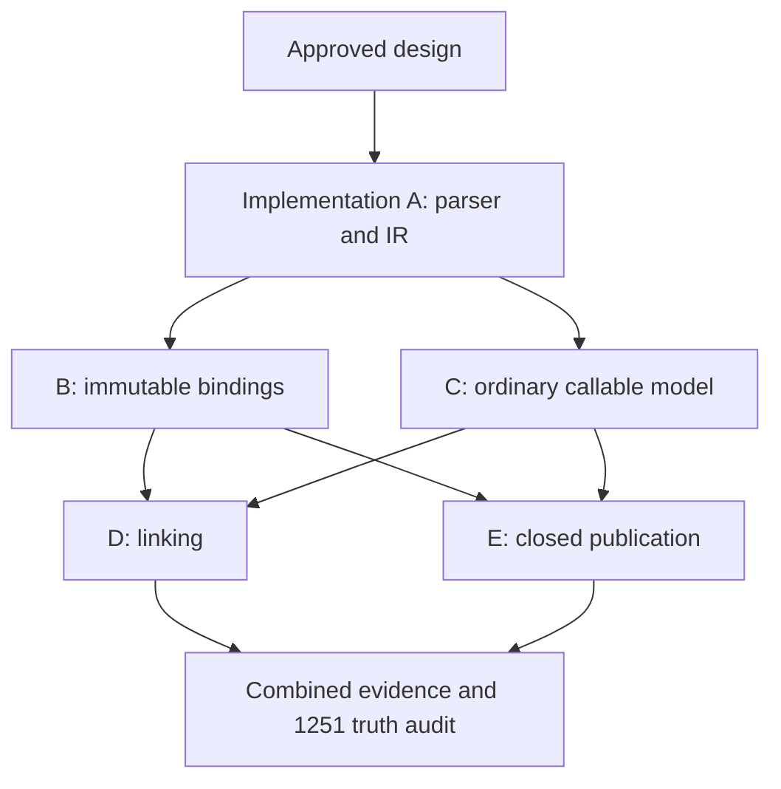

# Pre-R29 default-open functions and immutable bindings: portable design

Status: **DESIGN PROPOSAL — NOT IMPLEMENTED.** Issue [#1250](https://github.com/m0smith/genia-2026/issues/1250).
Scope: portable design gate only. This document is enduring architecture, not
execution evidence or a replacement language contract. No runtime, shared test,
capability claim, or implemented-truth change accompanies it.

The authority for the intended change is the [approved Model B contract](pre-r29-default-open-and-immutable-binding-contract-DRAFT.md),
merged by [#1255](https://github.com/m0smith/genia-2026/pull/1255) at
`a4730906a37450ae15aa2b595c69a1e9aa061e67`. Its filename retains DRAFT for
historical continuity; its current status records maintainer approval.
`GENIA_STATE.md` remains final authority for implemented behavior. Historical
R20 contracts describe the explicit-open path; this design does not rewrite them.

## 1. Architectural decisions

1. Keep ordinary `IrFuncDef` bodies, header bindings, annotations and source
   execution order. Do not translate them blindly into `IrOpenFuncDef`.
2. Add an explicit immutable-binding node and an explicit closed-group node.
   Closed grouping is represented in portable IR, not inferred by a dispatcher
   from source lines or a persistent parser table.
3. Give the existing ordinary function group an ordered base-unit adapter and
   optional module-owned interface provenance. Preserve its live identity.
   Reuse R20 shape selection, per-unit matching and the shared TCO trampoline;
   extend their records to preserve ordinary header frames.
4. Centralize binding-write validation and publication in the environment.
   Preflight targets before effects, then revalidate before mutation. Binding
   identity, callable identity, interface provenance and view identity are separate.
5. Freeze base clauses and three metadata observations at successful module
   completion. A linked view owns immutable selected records and projection;
   it must not read the base's changing live clause list or help map.
6. Use typed, scope-aware structural keys derived from portable patterns/guards.
   Link validation is atomic and precedes publication. No user code computes keys.
7. Closed publication is a state machine on the callable identity. Admission to
   initializing self-calls requires a synchronous declaration token, not merely
   access to the defining environment.
8. Reuse R16 and its capability vocabulary. New syntax is not evidence that a
   host supports the corresponding execution surface. No second runner or R41
   version-negotiation framework is introduced.

These decisions implement contract §§2–6. Internal class and helper names below
are suggested implementation choices unless explicitly identified as IR fields.

## 2. Baseline and implementation inventory

Inspection baseline: fetched `origin/main`, fast-forwarded to
`95213d1a65d366bfdd3aad55a0954fbabacc7637` on 2026-10-16. C++ source inspected
read-only at `87204407543f2b175c6b185bdc7e625edeb19251` in `m0smith/genia-cpp`.
These are source observations, not fresh cross-host conformance evidence.

Implemented today: nearest lexical assignment, assignable parameters, ordinary
arity groups, explicit R20 open interfaces, inert contributions and explicit
selection. `=:` and default openness are not implemented. STATE §§4, 4.7 and
8 govern dispatch, metadata and tail calls. STATE §0 describes the bounded C++
floor and R16; RULES §8 and the REPL/reference descriptions support those facts.

| Concern | Python files and actual integration points | C++ production files |
| --- | --- | --- |
| Tokenization / parsing | `src/genia/lexer.py:lex`; `parser.py:parse_program`, `try_parse_function_header`, `try_parse_bindable_toplevel`, `try_parse_name_assignment`, `parse_block`, `_parse_open_clause_list`; `ast_nodes.py:Assign`, `FuncDef`, `AnnotatedNode` | `src/parser.hpp`, `ast.hpp`, `ast_projection.hpp` |
| Portable representation | `ir.py:IrAssign`, `IrFuncDef`, `IrOpenFuncDef`, `IrOpenContribution`, `IrOpenUse`, `iter_ir_nodes`, `assert_portable_core_ir`; `lowering.py:lower_program`, `lower_node`, `_lower_annotations` | `core_ir.hpp`, `lowering.hpp`, `ir_projection.hpp` |
| Lexical ownership / writes | `environment.py:Env.set`, `assign`, `find_assign_target`, `define_function`, `merge_binding_metadata`, `_entry_route`, `binding_scope`, `binding_owner`, `is_runtime_owned`, `try_autoload`, `load_module`; `runtime_owned_manifest` | `environment.hpp:Environment.lookup/define`; `global_env.hpp`, `genia2026_known_globals.hpp` |
| Callable dispatch | `callable.py:GeniaFunctionGroup`, `GeniaFunction`, `OpenClauseRecord`, `_clause_shape`, `_open_dispatch_key`, `_structural_key`, `_first_unit_match`, `_dispatch_open`, `GeniaOpenFunction`, `GeniaLinkedOpenFunction` | `value.hpp:Closure`, `CaseClause`; `evaluator.hpp:eval_node` and closure invocation; `pattern_match.hpp` |
| Invocation / metadata | `evaluator.py:eval_annotations`, `_eval_impl`, `invoke_callable`, `eval_function_body`, `eval_case_expr`; `callable.py:invoke_callable`, `TailCall`, `eval_with_tco`; `builtins.py` reflection and `apply_raw`; `values.py:ModuleValue` and safe rendering | `evaluator.hpp`, `native_functions.hpp`, `render.hpp`, `equality.hpp` |
| Execution / portability | `interpreter.py:run_source`, `repl`, `is_complete`; `optimizer.py`; `hosts/python/parse_adapter.py`, `ir_normalize.py`, `protocol_adapter.py`; `tools/spec_runner/*` | `engine.hpp`, `main.cpp`, `adapter.hpp`, `protocol.hpp` |

Important baseline differences:

- `GeniaFunctionGroup.functions` is keyed by required arity; `add_clause` rejects
  duplicate arities and conflicting inline docs. Aliases hold the live group.
  It is not already a general ordered multi-pattern base unit.
- Explicit-open parsing flattens grouped bodies and checks header capture via
  `open_header_capture.py`. Ordinary bodies first bind header parameters and
  may then match a case body. Flattening loses those bindings.
- `_structural_key` currently returns primitive host values unchanged and walks
  dataclasses with one binder map. Python `True == 1` and nested binders therefore
  cannot define the new portable duplicate relation. Its `repr` fallback is also
  unsuitable as a portable encoding.
- Current `IrOpenUse` constructs a view and calls `Env.set`; it has no cross-unit
  duplicate/shape-conflict transaction. Current imported targets require
  `GeniaOpenFunction`, not ordinary groups.
- C++ `Environment.define` replaces its local map entry; `eval_node` currently
  constructs a fresh closure for each `FuncDef`/`OpenFuncDef`. Neither is enough
  for immutable lexical writes or live ordinary accumulation. Local R20 support
  does not establish module linking or annotations/TCO parity.
- R16 `eval` accepts source, not serialized IR. `lower` returns normalized IR.
  Direct-IR equivalence therefore needs host-local evaluator tests in addition
  to portable source/lowering cases; no new protocol operation is needed.

### Module-scope boundary

[#1229](https://github.com/m0smith/genia-2026/issues/1229) owns closeout evidence.
[#1230](https://github.com/m0smith/genia-2026/issues/1230) records fallback removal
by [#1254](https://github.com/m0smith/genia-2026/pull/1254), merge `e551021`.
There is no remaining module-to-entry read fallback to preserve or reintroduce.
Entry writes to runtime-owned names still route through R; their retirement is
separate work (#1257). Retain R/E/M topology, module `rebind_parent=False`,
scope-bound reflection, explicit host-injection classes and unit ownership.
Immutable declarations must not accidentally invoke entry write-through.

## 3. Parser and portable Core IR

### 3.1 Tokens and grouping

Recognize `=:` as one longest-match token, before `=` and `:`. It is a declaration
introducer, not an infix expression. `==`, `=>`-like invalid input, arrows, map
colons, quoted strings/comments and ordinary assignment keep their own rules.
Accept only a simple name or permitted named-function header to its left;
reject member/index/computed targets and unsupported nested named definitions.
Extend bindable-target parsing and completeness checks, not expression precedence.

Parse a closed group as a maximal consecutive run of same-name `=:` declarations
within one program submission. Blank lines/comments do not split it; another
statement does. Prefix annotations belong to their following declaration and
do not alone split the run. Reject mixing `=` and `=:` in the same declaration
run. A later same-scope declaration is a runtime collision, so persistent REPL
state is enforced without teaching the parser about previous submissions.
End-of-program is an explicit end of the last group. Multiline input collects
one group only if it is one complete submission under the existing REPL rules;
do not extend a successfully submitted closed function on a later input line.

Ordinary declarations remain individual source-ordered statements, including
noncontiguous declarations. Explicit `open` retains its current contiguous-run,
grouped-body and annotation rules. No nested function syntax is added.

### 3.2 Chosen carriers

The following are proposed portable schema decisions, not current classes:

| Node | Fields / interpretation |
| --- | --- |
| `IrImmutableBind` (new) | `name`, `expr`, ordered `annotations=[]`, `span`; fresh current-scope immutable declaration |
| `IrFuncDef` (retained) | Existing fields unchanged; optional `pattern` and `guard` for pattern-headed declarations where approved. Omit absent fields in normalization. Plain headers keep `params/rest_param`; `pattern`, when present, is a full `IrPatTuple` whose bindings supply the header frame. Rest/arity information must agree, otherwise reject malformed direct IR. |
| `IrClosedFuncDef` (new) | `name`, nonempty ordered `declarations: list[IrFuncDef]`, `span`; one complete closed group, never independently evaluated child definitions |
| Existing R20 nodes | Keep existing shapes. `IrOpenFuncDef` still denotes historical explicit-open construction; contribution and selection nodes remain unchanged. |

AST mirrors fresh binding and closed-group boundaries; annotation wrappers are
preserved per child declaration. A child `IrFuncDef` in a closed group is a
declaration record, not an instruction to publish a second binding. Validate
equal names, valid header patterns, metadata target restrictions and absence of
nested closed groups. Do not encode callable lifecycle state, host closures or
runtime identities into JSON.

Ordinary identifier headers retain their existing wire form, including grouped
`IrCase` bodies. A runtime adapter constructs dispatch records while retaining
the header binder/body pair. For structural duplicate checks, derive logical
case-arm keys without discarding that pair. A plain expression-body declaration
derives one key from its header and guard; grouped arms derive keys from the
argument-pattern/guard structure with scope-aware header references. Preserve
both declaration and arm ordinals, because runtime source order and grouped
header capture must survive this projection. Bodies do not enter duplicate keys.

Pattern headers use existing `IrPat*` forms and guards; they introduce no new
matcher language. Do not broaden the separately restricted explicit-open body
grammar. `=`/`->`/block spellings that already define ordinary functions all
take the ordinary path, with default openness determined by declaration ownership.

### 3.3 Alternatives and compatibility decision

| Alternative | Benefit | Rejection / decision |
| --- | --- | --- |
| Lower every ordinary/closed function to `IrOpenFuncDef` and encode closedness as an annotation | Few node kinds | Reject: loses ordinary header capture, docstrings and metadata failure timing; annotations are inert metadata, not binding authority. |
| Add flags to `IrAssign`/`IrFuncDef`, infer closed runs from adjacent statements during evaluation | Small schema diff | Reject for closed grouping: arbitrary direct-IR streaming can split a group; missing flags can silently downgrade immutability. |
| Explicit new immutable-bind and closed-group nodes; retain ordinary declarations with optional pattern/guard | Old ordinary snapshots stay stable, new authority cannot be silently dropped by an old evaluator | **Choose.** Two new node families and a narrow optional-header extension; reuse existing bodies, patterns and annotations. |

The node extension is additive in shape but default-open interpretation of an
existing `IrFuncDef` is a semantic compatibility change. Existing manifest
`core_ir_version` is `0.1.0`; do not claim unchanged-version semantic compatibility.
Reserve `0.2.0` for the completed Model B interpretation and record it in the
manifest/portable-boundary documentation when that interpretation lands. A may
land additive carriers under the existing interpretation, with the schema
addition documented and unknown-node rejection tested; C must make the semantic
version transition explicit. Do not advertise the completed epoch in A alone.
Old ordinary normalized snapshots should remain byte-equivalent when no new
header fields occur; new node consumers need explicit support. Already-pinned
artifacts stay tied to their original contract revision. Re-running old serialized
IR with a new runtime is not promised to preserve old closed-default semantics.

R16 protocol version `1` is independent and stays unchanged. Its exact
`contract_revision` pins evidence. An ancestor-revision run proves compatibility
only, not current pinned conformance. There is no universal serialized-IR loader
to retrofit; audit normalizers, projections, optimizers, walkers and known
in-process constructors. If a real external consumer requires migration,
record its version boundary rather than invent a general R41 negotiation layer.

### 3.4 Source/direct-IR equivalence and provenance

Evaluators must validate immutable declarations and whole closed groups even
when parser validation was bypassed. Direct IR supplies the closed group as one
node; two adjacent group nodes do not implicitly combine. Source runs and their
lowered IR must agree on effects, errors, dispatch, annotations and publication.
Optimizers may optimize child bodies but cannot move declarations/annotations
across execution or publication boundaries.

Keep source spans on every declaration, annotation, pattern/guard and case arm.
Derive unit provenance from the declaring module tree and canonical module
identity; derive declaration/arm ordinals from ordered lists and accumulated
execution order. Runtime records carry those values plus lexical closure.
Keys omit spans; diagnostics preserve both conflicting provenances. Render
canonical imported module names or the existing entry label, never filesystem
paths, object addresses or captured values. Span-free direct IR has deterministic
unknown-location diagnostics; it cannot fabricate source locations.

## 4. Binding environment design

Introduce explicit binding policy alongside values and binding metadata. It must
distinguish mutable, immutable and provisional reservation; existing
`assignable` membership alone does not distinguish fresh declaration, closed
publication or ownership. Prefer one environment-owned policy record/side table
over converting every value lookup into a new public binding value.

The invariant is: **every language-visible write resolves its intended binding
owner, checks that operation's authority and mutability, and commits value and
metadata only through that owner. No writer bypasses an immutable binding.**
The operation kind matters: annotation attachment to the declaration currently
being committed is not an unrelated reassignment; a later annotation writer
cannot use this exception to mutate an immutable defining binding.

Suggested internal operations: `prepare_write(name, kind)`,
`declare_immutable`, `commit_write`, `publish_closed`, `abort_closed`.
Preparation returns an internal owner/policy token, not language authority.
Revalidate it at commit: an initializer/annotation can execute code and change
the environment after preparation. Do not roll back user effects on failure.

| Writer / scope | Resolution and rule |
| --- | --- |
| Fresh `=:` | Current lexical declaration scope only; fail on any existing local binding, including a parameter or import alias. Entry reserved-name check runs before initializer/autoload. Explicit nested declaration may shadow an outer user binding. |
| Ordinary `=` | Existing nearest-binding algorithm and `rebind_parent` boundaries; fail at nearest immutable binding, never continue outward or manufacture a shadow. Check before RHS when target is already invalid. |
| Parameters / case bindings | Fresh call/match frame locals, mutable as today. Their later `=:` redeclaration fails. |
| Named declaration | Current declaration owner; append only to that owner's compatible ordinary base unit. Never append through an arbitrary callable alias or imported binding; immutable/closed collisions fail before annotations. |
| `import` alias / `use` local name | Validate local publication target before loading/linking effects where invalidity is already known. Existing mutable replacement behavior remains, including `use` replacing an ordinary mutable binding. Immutable target rejects. Import does not make a foreign interface locally owned. |
| Annotations | Attach only after the relevant declaration transaction validates; use binding owner rather than name-only lookup. Preserve ordinary metadata on unannotated rebinding. |
| Prelude / autoload / metacircular writers | Route installation and `_meta_define`/`_meta_set` through checked environment operations; no raw table write may overwrite immutable user state. Trusted runtime bootstrap is separate from subsequent language-visible writes. |
| Persistent REPL | Retain policy and callable identities across submissions; failed closed reservations are withdrawn, committed immutable definitions remain sealed. A permissible later reuse after failure gets a fresh identity. |

Audit direct `values[...]` mutations and every `set`, `assign`, `define_function`,
metadata merge and import/use installation. A post-RHS `Env.assign` check alone
cannot satisfy pre-effect rejection. Internal rollback removes only the exact
provisional reservation it owns; it must not erase an unrelated newer binding.

`Env.is_runtime_owned` already combines runtime/internal values, registered
autoload names and the static prelude manifest. Reuse this non-acquiring source,
including unloaded/unregistered helper names. C++ must represent the same reserved
name boundary, including prelude names it has not evaluated, rather than use
only its current environment contents. Unsupported prelude execution is not
permission to accept a forbidden immutable declaration. Keep entry host-injection
visibility rules and the existing ordinary `=` write-through route intact.

## 5. Callable, interface and linking design

### 5.1 Four identities

- **Binding:** lexical owner plus name and policy; aliases have separate bindings.
- **Callable:** opaque identity with live ordinary accumulation or closed state;
  aliases retain R18 callable equality. Re-evaluation creates new callable identity.
- **Interface:** original module-owned declaration provenance, diagnostic key
  `(canonical module identity, defining name)` within an execution. A re-export
  retains it. Lambda/builtin/host-callable aliases never acquire it from their name.
- **View:** a fresh identity holding frozen selected units and metadata, referring
  to the base interface provenance but never becoming an extendable interface.

Keep provenance on the declared callable, not reconstructed from an export's
current spelling. Local lambda factories remain ordinary distinct callables.
No module identity or ownership is inferred merely from `callable(value)`.

### 5.2 Ordinary accumulation and one dispatch engine

Extend/adapt `GeniaFunctionGroup` in place so aliases continue to share the same
object. Add ordered declaration records and a stable owner/defining-name token.
The arity map can remain an index where valid, but cannot be the semantic record
store once distinct patterns of the same shape are permitted. No clause is
visible until its statement executes; validate proposed additions before
changing the live record set. Preserve conflicting-inline-doc rejection before
installation and ordinary annotation failure after installation.

Adapt each ordinary declaration into the existing R20 unit dispatcher. Its
header frame binds identifiers/rest values; a grouped case retains access to
those header bindings while matching the original full argument tuple. Candidate
discovery runs patterns/guards once and retains the selected bindings. Invocation
does not rerun effectful matchers. Grouped arms carry their own keys/provenance,
while the declaration's header closure remains available to the winning body.

Use the same shape stratum, first candidate per unit and across-unit ambiguity
algorithm. Preserve ordinary fixed/varargs and Outcome awareness, including
case-body/delegation inspection. Keep `GeniaFunction` as a body/header execution
record and use `eval_with_tco`/`TailCall`; do not add another trampoline. Historical
explicit-open construction uses the same dispatcher with its existing parsing
and interface-owned metadata policy. Ordinary syntax has a different construction
policy, not a second dispatch language.

### 5.3 Completion and atomic linking

`Env.load_module` is the completion boundary: after `run_source` succeeds and
before `ModuleValue` enters the completed cache, freeze each exported ordinary
base interface's ordered clause records and metadata projection once. Failed or
loading modules are not linkable. Re-exported interface aliases retain the
original completed snapshot; do not recapture their alias binding metadata.

`extend` accepts an exported module-owned ordinary or explicit-open interface,
never a linked view, closed callable, arbitrary alias-created interface or an
unfinished module. Contributions retain their own closures and accumulate
inertly in the existing contribution table. Plain imports select nothing.

`use` resolves completed base/contributors, checks exact target and duplicate
selection identities, validates all selected records, constructs the frozen
view privately, then publishes through the checked binding writer. Reject
equal keys across participating units and cross-unit fixed `n` versus varargs
minimum `m <= n`, irrespective of possible pattern disjointness. Within-unit
shape precedence stays unchanged. Deterministic validation order is base first,
then canonical contributor identity, then lexical record ordinal; `with` order
cannot choose a winner. Report both relevant provenances without evaluating
matchers/guards. Existing views survive failed later selection unchanged.

Distinct overlapping keys remain legal and may yield runtime ambiguity. There
is no override or specificity ranking, and guard/matcher effects during actual
candidate discovery are not promised to commute.

### 5.4 Portable structural keys

Use one pure structural walker over the portable pattern/guard vocabulary,
replacing the host-dependent implementation of `_open_dispatch_key` rather
than introducing a parallel semantic-key service. The logical key is
`(shape, normalized-pattern, normalized-guard)`.

Encode primitives with explicit tags (boolean, integer, decimal, string, symbol,
absence); preserve numeric source payload structure, constructor and operator
tags and ordered fields. Never use host numeric equality, hash iteration, class
names or `repr`. Normalize bound names by lexical binder depth and first-occurrence
slot. Repeated bindings reuse their slot; rest bindings participate. For guards,
lambda parameters, nested case arms and block-local declarations push/pop binder
frames; visit initializer before introducing its fresh binder. References to
outer pattern binders retain their outer slot under shadowing. Free names and
named matcher references remain syntactic references, not captured-value hashes.
Quoted syntax is data; only active unquotes are expression references at the
appropriate quasiquote depth. Preserve the existing structural ordering of
patterns/maps; do not silently add semantic map-equivalence normalization.

Reject unsupported/malformed key structures deterministically, never fall back
to host rendering. Cache the key on immutable clause records; no guard, matcher
or body runs during validation. Different runtime captures with equal syntax
remain syntactic duplicates as the contract requires.

## 6. Metadata and closed publication

### 6.1 Metadata channels

| Channel | Owner and acquisition | Publication / lookup |
| --- | --- | --- |
| Binding annotations | Declaring lexical binding; evaluate/validate each annotation in order, stopping on first failure | Merge newer keys only after whole declaration list succeeds. Unannotated aliases have no annotation copy; annotated ordinary aliases own their map. |
| Inline documentation | Shared ordinary callable group; check consistency before adding a clause | `doc(name)` falls back here after binding `@doc`. |
| Effective help | Shared ordinary callable help map plus its own inline fallback | Alias annotations can affect shared help without changing another binding's `doc`/`meta`. |
| Export/view projection | At original base module's successful completion: defining annotation map, effective defining `doc`, independently effective help text/summary | Freeze all three observations separately. `meta(view)`, `doc(view)`, `help(view)` use their respective channel and selected provenance. Contributor/local alias annotations never overlay them. |

Freeze Genia metadata values using existing immutable value semantics; the
projection is not a deep-freeze of Ref/Cell capabilities. It must never retain a
mutable host dictionary as the authoritative map. Preserve missing-doc behavior
as well as present text. A defining `@doc` is not the help fallback if shared
help instead falls back to inline documentation. Preserve explicit R20's
interface-owned metadata and annotation restrictions through a construction
policy discriminator; do not migrate it to binding-owned metadata implicitly.

For ordinary declarations, retain preliminary route/HTTP/native-test restrictions,
install the validated clause, then run `eval_annotations` in order, validating
each result immediately. Accumulate a private map, perform replacement guards,
and commit once. Failure leaves the clause and prior metadata; earlier effects
persist, later annotations never run. No partially merged map escapes.

### 6.2 Closed callable state machine

`structurally validated -> initializing -> committed | failed`.
Validate the complete group's shapes, duplicate keys, mixing, inline-doc
consistency, binding freshness and permitted annotations before provisional
publication. Construction does not call user annotations during structural
validation. Prepare a private self-binding frame containing the provisional
callable and capture that self identity in its clause closures. It shadows the
outside name for recursion without exposing a completed binding globally.

The declaration owner also holds a provisional name reservation: lookup from
the admitted synchronous annotation call chain can resolve it, including inside
an annotation helper whose lexical closure is the module environment rather
than the private self frame. Other lookup contexts do not see a completed
binding. Reservation lookup must consult admission state; a private frame alone
would fail this helper case. An escaped reference remains transportable and is
guarded at actual callable use.

During ordered annotation evaluation, use the private frame so synchronous
calls by the annotation and recursive calls see self. An internal admission
token must identify this declaration transaction **and** synchronous execution
lineage; a copied context variable alone is insufficient because processes/tasks
may inherit context. Fresh process/task entry does not inherit admission, even
if it receives the callable. Host realization may use a thread/task identity
plus a dynamic call-stack token, checked at all entry points. No new language
capability or cancellation mechanism results.

Commit the immutable binding and collected metadata only after the full group
annotation sequence succeeds. On failure, first permanently mark the exact
callable identity failed, then withdraw its provisional reservation/frame
visibility. Do not undo annotation side effects or references stored in Ref/Cell,
collections or closures. Later permissible name reuse creates a new callable;
old escaped references never resolve recursion through that later binding.

Initializing external invocation/introspection rejects with
`closed-function-not-yet-published`; failed callable use rejects with
`closed-function-failed-publication`. Check the target state before invocation's
none/err propagation, arity/matching/guard/body handling in `invoke_callable`,
direct `__call__`, TCO steps, matcher invocation and host higher-order bridges
including `apply_raw`. Reflection and extend/use target checks share the state
guard. Transport itself must not use that guard: assignment, argument passing,
return, equality and safe rendering remain valid. An upstream Flow/Outcome
operation which skips invocation still skips it. Generic rendering uses a
sanitized opaque marker and exposes no source, metadata, closures or protected
payload. Closedness follows the callable through mutable aliases; immutability
applies to the defining binding.

## 7. Multi-host portability and evidence plan

All rows below are **planned**, with shared contract authority in §§2–6 of
Model B. Capability names come from the existing manifest; no new names are
needed merely to hide a regression in an already-supported surface.

| Surface / portable observation | Representation / shared evidence | Applicability | Python impact | C++ impact / boundary |
| --- | --- | --- | --- | --- |
| `=:` token, fresh binding, closed grouping | AST projection, new nodes, parse/IR snapshots | `parser`, `ast_lowering` | Parser/lowerer/normalizers/walkers | Same carriers in C++ projections; unsupported syntax must not be silently parsed as assignment |
| Lexical write rejection, effects, shadowing, shallow mutability | Immutable-bind evaluation; eval/error cases | `core_ir_eval`; add `refs`/`cell_primitives` where used | Central checked writer and reserved-name manifest | Replace local-only `define` for assignment with nearest-binding operation and binding policy; static reserved-name boundary |
| Live ordinary group, header capture, aliases and ownership | Existing `IrFuncDef`; source eval + direct-IR twins | `core_ir_eval`, `open_functions` for extension cases | Ordered group adapter and shared dispatch | Identity-bearing accumulation replaces fresh closure replacement; preserve bounded ordinary behavior |
| Inert contributions, exact keys, ambiguity and frozen views | Existing contribution/use nodes; logical module fixtures | `open_functions`, `multi_file_eval` | Link transaction and module completion snapshot | Cross-module loading/linking remains unsupported until implemented; local `open_functions` stays evidenced separately |
| Closed publication, failed transport/use | Closed-group IR, eval/error/CLI cases | `core_ir_eval`; `doc_help`, `process_primitives`, `refs` as actually needed | State guards, private self frame and admission token | Local closed execution requires state-bearing closure; annotations/process combinations remain separately unsupported where unevidenced |
| Metadata channels and view snapshots | Ordered annotations / module completion; eval output | `doc_help`; `multi_file_eval` and `open_functions` for views | Reflection lookup and snapshot projection | Annotation and doc/help boundaries are not established by current local R20 support |
| REPL sealing and recovery | Whole group per submission, persistent environment | `repl` | Retain policy across `run_source` calls | `engine.hpp` session must preserve policy and identity |
| Recursion, TCO, Outcome/Flow non-regression | Existing calls/TailCall and pipeline boundaries | Existing case requirements, `flow_phase_1` where needed | Shared trampoline + target admission ordering | No C++ TCO claim; retain exact case-level unsupported evidence |

Shared R16 `lower` checks portable IR before optimization. `eval`/`cli` check
normalized output and diagnostics. Direct-IR twins are local implementation
tests because protocol input is source; they do not replace shared tests.
Process admission gets deterministic host tests using barriers, not timing
assumptions; portable spawn/Ref observations get shared twins wherever expressible.

Gap policy: #1250 is the tracking issue; accountable owner is @m0smith until
reassigned. Before each implementation merge, update affected entries in
`spec/known_host_gaps.json` with host, exact cases/area, reason and removal
condition. Existing `multi_file_eval` gap remains until C++ completes loading,
ownership, snapshot/link checks and passes those shared cases at the pinned
revision. Closed metadata and TCO gaps require exact per-case unsupported
evidence under existing capabilities, not a new broad capability downgrade.
Do not add a stale optional-capability entry for supported `open_functions`:
the current parity gate works at capability granularity, while adapter evidence
also records unsupported individual cases. Explain this limit in merge evidence.
If that gate cannot express a needed temporary distinction, stop that merge for
a bounded tracking/policy decision; do not fabricate a passing capability claim.

No host may mark old ordinary cases unsupported merely to avoid the new work.
Both host results, unsupported counts and failure-class counts must be retained;
zero failures alone is not parity. Existing R24–R27 evidence is historical,
not proof for Model B. No production-host changes occur in this design phase.

## 8. Shared red-test inventory (no tests added here)

Suggested IDs below identify observations, not approved literal error wording.
The test phase must lock exact outputs/normalized categories against the contract
and preserve red commit SHA. Use multiple cases where one failure would prevent
later observations; do not hide negative assertions behind the first exception.

| Family / proposed IDs | Required observations |
| --- | --- |
| A `model-b-parse-*`, `model-b-ir-*` | Longest token; invalid targets; adjacent closed clauses; comments/blank lines; statement boundary; annotations per clause; end-of-submission; `=`/arrow/block compatibility; nested named rejection; immutable-bind and closed-group normalized fields; grouped header/body preservation; explicit R20 snapshots unchanged |
| B `model-b-binding-*` | Fresh local/entry declaration; same-scope duplicate; nearest immutable assignment; explicit nested shadow; assignable parameters; immutable parameter/import collision; closure write; reserved loaded/unloaded prelude names; rejected RHS sentinel effects; Ref/Cell mutation allowed; import/use/named-pattern/named-function/autoload/metacircular writers cannot overwrite |
| C `model-b-ordinary-*` | Noncontiguous arities and live alias; call before later clause fails; grouped header capture; same-shape distinct pattern source order; duplicate keys; fixed/varargs and Outcome behavior; lambda/host/builtin alias not interface; original re-export provenance; inline docs and all three ordinary metadata observations |
| D `model-b-link-*` | Base alone/import inert; selection activation; duplicate selection through aliases; cross-unit alpha-equivalent keys; `true` versus `1`; nested guard/lambda shadowing/free-name distinctions; no key-computation effects; fixed/varargs cross-unit conflict including disjoint patterns; distinct overlap ambiguity; reordered imports/selections; failed/unfinished modules; foreign closure ownership; view clauses and three metadata snapshots; future views frozen despite later alias help changes; view alias annotations cannot overlay; explicit-open metadata compatibility |
| E `model-b-closed-*` | Closed run recursion; later/noncontiguous clause rejection; immutable defining-name and mutable alias distinction; mixing and prevalidation effects; provisional annotation self-call; ordered annotations/atomic metadata; failed escaped value assignment/collection/closure/equality/render; direct/HOF/apply_raw/TCO/matcher failures before none/err propagation; upstream skipped callback unchanged; process admission denied; failed introspection/link targeting; later REPL name reuse cannot revive old identity |
| Cross-cutting `model-b-mode-*` | Command/file/import/REPL equivalents; deep self/mutual TCO on supported host; validated-record pipeline; bounded lazy Flow callback demand/cleanup; protected sentinel absent from diagnostics and failed rendering; scope-bound doc/meta/help; module cannot read entry binding; entry runtime-owned `=` behavior unchanged |

Retain existing `tests/spec/test_r20_open_functions_shared_specs.py`,
`tests/unit/test_r20_open_functions_{annotations,cross_module,diagnostics}.py`,
`test_prefix_annotations.py`, `test_lexical_assignment.py`, REPL characterization,
F2 module isolation, R8/R14 annotation/discovery and callable/Outcome regressions.
Portable-only additions to Python tests need shared twins; parser internals,
direct IR, thread admission, optimizer invariants and private policy-token checks
are legitimate host-local tests. Native tests alone do not prove C++ behavior.

## 9. Independently mergeable slices

The **design Slice A** requested by this task is this whole document. The
implementation slice **A** below is a later phase, not authority to code now.
Each slice has a separate failing-test commit before implementation; the
implementation must reference that SHA. Child GitHub tickets are unnecessary;
use #1250, bounded branches/PRs and explicit merge dependencies.

| Slice | Responsibility / likely files | Dependencies and red-first acceptance | Compatibility / capabilities / rollback |
| --- | --- | --- | --- |
| A — Parser and Core IR | Python lexer/parser/AST/IR/lowering, adapters/normalizers/walkers/optimizer; C++ parser/AST/Core IR/lowering/projections; portable-boundary docs | Approved design; A inventory red first. New carriers/group boundaries and malformed-IR validation specified; parser/lower snapshots pass in both hosts or exact gap recorded. Execution of unimplemented new nodes must reject, never downgrade to mutable behavior. | Ordinary/R20 snapshots and body capture unchanged. `parser`/`ast_lowering` evidence only; no semantic capability claim from syntax. Rollback removes carriers and snapshots together, no stored runtime state. |
| B — Immutable bindings | Python environment/evaluator/prelude manifest/metacircular writers; C++ environment/evaluator/global inventory | A; B shared red commit. Every writer checked, target-invalid effects suppressed, shadow and shallow capability tests pass. | F2 topology and runtime-owned `=` write-through unchanged. `core_ir_eval` plus concern-specific requirements; host gaps explicit. Rollback before shipping consumers; never reinterpret existing immutable declarations as mutable. |
| C — Default-open ordinary functions | Python callable/evaluator/environment/module exports; C++ value/evaluator/environment; reflection compatibility adapters | A; C red commit. Stable live group, ordered records/header capture and ownership, ordinary metadata tests; module completion projections available for D. Coordinate writer API with B. | Preserve ordinary arity/Outcome/TCO and explicit-open tests except approved deltas. Explicit Core IR semantic version transition. Rollback C with dependent D; snapshot/identity changes cannot be reverted independently after dependent views ship. |
| D — Cross-module linking | Python callable key walker/linker, evaluator extend/use, environment module completion, ModuleValue/reflection; corresponding C++ module work only if separately scoped to existing gap | B + C; D red commit. Typed scope-aware keys, atomic duplicates/shapes and selected snapshots verified; no inert import activation. | `open_functions` + `multi_file_eval`, metadata requirements as needed. C++ module gap stays explicit; no assumed parity. Rollback whole link transaction and its consumers, never leave half-published views. |
| E — Closed functions | Python evaluator/callable/environment/reflection/render/interpreter; C++ closure/evaluator/environment/render/session support | B + C's common clause/body adapter; E red commit. Whole-group structural validation, self-call admission, committed/failed state, transport and pre-propagation guards pass. D not required for local implementation; combined negative targeting tests follow D. | Existing annotations/REPL/recursion preserved, immutable definition sealed. `core_ir_eval`/`repl`/`doc_help` and process combinations honestly evidenced. Rollback E with its syntax consumers; escaped identity cannot be revived by runtime rollback. |

Dependency graph:

B and C can develop in parallel after A if they agree on the checked-writer
API and assign environment/evaluator edits to one integration owner. Prefer B
merged before C to minimize overlapping write paths; C must not introduce a
bypass. D and E can develop in parallel after B/C with shared callable-state
and key interfaces fixed, but their common evaluator/callable/reflection edits
require integration review. Final D+E targeting and snapshot/state checks are
an integration gate, not permission to omit them from either host's evidence.
Python/C++ implementations of a bounded slice may proceed independently from
the same contract and shared red inventory, without reading Python to decide
semantics. Parallel eligibility is a dependency plan, not agent delegation in
this run.

Each implementation PR must include shared red SHA, scope/file inventory,
maintained-code documentation, relevant supported-host evidence and gaps,
compatibility deltas, documentation synchronization and rollback boundary.
Run maintainability review before the independent behavioral/truth audit.

## 10. Migration, risks and truth synchronization

Intentional deltas: ordinary exported declarations become eligible targets;
cross-unit equal keys and fixed/varargs conflicts now fail at selection; view
metadata no longer accepts the ordinary-base local alias overlay. These are
approved changes, not regressions to disguise with skipped legacy tests.
Historical explicit-open syntax/annotation policy remains; no mass rewrite of
prelude/examples or added `@closed` spelling is authorized.

Main implementation risks are grouped-header capture under key projection,
duplicate same-shape migration from the arity dictionary, all-writer enforcement
before effects, frozen help fallback independence, and initializing-call admission
under copied process context. Require counterexamples from §8 before accepting
the corresponding implementation. A failed initializer can mutate unrelated
state; transactions cover binding/clause/metadata publication, not arbitrary IO.

Reserved-name consistency must be checked against the shared prelude inventory
for each host, rather than C++'s bounded loaded globals. Key encoding cannot
borrow Python dataclass names or equality. No broad export/privacy redesign,
P3 write-through retirement, nested named functions, deep immutability or new
execution framework belongs here.

Future implementation prompts must explicitly require same-change synchronization
of implemented truth once behavior is verified: `GENIA_STATE.md`,
`GENIA_RULES.md`, `GENIA_REPL_README.md`, `README.md`, relevant `docs/book/`
chapters, reviewed cheatsheets (including core and unix-power-mode), portable
Core IR/capability docs and host matrix, release evidence and examples.
For MCP, this change **does affect language knowledge once implemented**:
update `docs/contract/semantic_facts.json`'s `mcp_language_profile` facts and STATE
anchors/evidence, regenerate `apps/mcp/mcp.genia` with the existing generator,
and run its check and semantic/doc sync tests. Do not regenerate it now.
Run cheatsheet sidecar validation if runnable cheatsheet examples change;
composability-matrix review applies if callable/Template composition descriptions
change. #1251 owns integrated truth audit/distillation, not permission to defer
truthful per-slice documentation until after a misleading implementation merge.

## 11. Decisions, remaining choices and gate

Fixed by contract: default module-owned openness, inert explicit selection,
duplicate/overlap rules, fresh shallow immutable bindings, closed group lifetime,
provisional/failed behavior and the distinct metadata channels. This design
chooses their carriers, owner-checked publication and reuse boundaries.

Implementation choices remaining: exact environment record layout, clause index
cache, internal transaction-token names, admission-token realization and C++
memory ownership. They may change without changing portable observations.
Cycles between self closures and environments need the host's existing ownership
discipline; no new garbage-collection semantics are specified. The version
transition is required; a broader historical-IR loader is not.

**GO for the next bounded failing-test phase: implementation A's parser/Core IR
inventory only, after this design is accepted.** No unresolved contract choice
has been identified. This is not GO for runtime implementation, whole-release
parity claims or R29 behavior. The operational risks above are red-test and
implementation acceptance obligations. Stop if a direct-IR or key counterexample
requires a new semantic choice; resolve it in #1249 rather than let a host decide.

Exact next bounded task:

> On current main after this #1250 design merges, read AGENTS.md, the approved
> Model B contract from #1255 and this design. Perform TEST ONLY for implementation
> slice A: add failing shared R16 parse/lowering cases for `=:` fresh bindings,
> closed contiguous groups and boundaries, per-declaration annotations, pattern
> headers and preserved ordinary grouped bodies; retain ordinary and explicit
> R20 compatibility cases. Add necessary host-local malformed/direct-IR validation
> tests without adding runtime carriers or parser implementation. Reuse existing
> capability vocabulary and runner; record baseline failures and Python/C++
> applicability honestly. Commit/push with `test(...) ... issue #1250`, open a
> bounded PR, and report the red SHA. Do not implement A–E, change implemented
> STATE/MCP claims, or proceed to another phase. The subsequent implementation
> prompt must cite that red SHA and explicitly require verified-behavior sync
> of STATE/RULES/REPL README/README, book/cheatsheets, semantic registry/generated
> MCP profile, portable IR/capability documentation and release evidence.

## 12. Sources and evidence limits

- `GENIA_STATE.md`, `GENIA_RULES.md`,
  `GENIA_REPL_README.md`, `README.md`, in that order.
- [Approved Model B contract](pre-r29-default-open-and-immutable-binding-contract-DRAFT.md),
  especially §§2.2–2.3, 3, 4, 5 and 6; historical
  [R20 contract](r20-open-functions-contract.md) and
  [syntax/IR design](r20-open-functions-syntax-ir-design.md).
- [Core IR boundary](../architecture/core-ir-portability.md),
  [executable conformance](../architecture/executable-semantic-conformance.md),
  `docs/process/run-change.md`, `docs/strategy/killer-workflow.md`,
  [roadmap](../strategy/release-roadmap.md), [sequence](../strategy/roadmap/sequence.md).
- [#1249](https://github.com/m0smith/genia-2026/issues/1249),
  [#1250](https://github.com/m0smith/genia-2026/issues/1250),
  [#1251](https://github.com/m0smith/genia-2026/issues/1251), #1229/#1230 and
  merged #1254 reviewed through GitHub issue/PR records; current file status and
  main override stale proposal text in historical issue/PR bodies.
- Actual source integration points are inventoried in §2; `spec/manifest.json`,
  `spec/known_host_gaps.json`, `tools/spec_runner/protocol.py` and C++
  `protocol.hpp` establish existing versions, capabilities and evidence limits.

This design does not claim Model B tests pass, full regression, executed C++
parity, or resolution of separate #1229/#1257 work. Verification of this document
must be reported separately from future implementation evidence.

## 13. Independent Claude design review — required corrections (2026-10-16; NOT IMPLEMENTED)

**Verdict: REVISE.** Independent review of PR #1259 head `3fad20d` found no fundamental Model B architectural contradiction, but the Slice A TEST ONLY gate must stay **CONDITIONAL / NOT YET AUTHORIZED** until the following decisions are incorporated and independently re-checked. The rules below **supersede conflicting earlier design wording**, without changing the approved contract or claiming implemented behavior.

### 13.1 Header grammar — explicit additional maintainer decision required (F1)

**Proposed syntax**, subject to maintainer confirmation: ordinary and closed named function headers use the existing historical explicit-R20-`open` lambda-parameter-pattern grammar, `name(<lambda-parameter-pattern-list>) [? guard]`, followed by the otherwise permitted declaration separator/body (`=`, `=:`, `->`, or block where already legal). Pattern types and guard placement must exactly follow the portable existing `open` restrictions; do not invent a matcher language. Grouped `IrCase` bodies require an identifier-only header with no header guard (same rejection as `open`). Identifier-only ordinary headers retain their existing normalized wire form. A closed declaration containing a pattern header must remain one child of its atomic group. **Do not authorize pattern-headed shared red tests until the maintainer approves this syntax choice.**

The present contract's phrase `f(pattern) = expr` is insufficient to settle the exact grammar on its own. This is the review's one unresolved explicit semantic choice, not an implementation detail.

### 13.2 IR carrier, source/direct IR and phased acceptance (F3, F7, F8)

Choose a **distinct `IrPatternFuncDef`** for an ordinary or closed pattern-headed clause, instead of adding optional `pattern`/`guard` fields to the legacy `IrFuncDef` that an old evaluator could ignore. It has `name`, one required full tuple pattern, optional guard, body, annotations and span; it has **no competing `params/rest_param` interpretation**. Legacy identifier-header `IrFuncDef` wire normalization remains byte-stable. `IrClosedFuncDef.declarations` contains nonempty ordered declaration records of legacy `IrFuncDef` or `IrPatternFuncDef`, only after grammar approval. Unknown carriers and malformed direct IR must reject explicitly, never downgrade semantics. Iterators, normalizers and optimizers must traverse *all* children (including existing R20 nodes) and reject host-local nested nodes.

**Mixed operator phase:** a contiguous same-name declaration run containing both `=` and `=:` fails at parse/lower time with proposed normalized category `mixed-function-declaration-operators`, before evaluation. A later same-name declaration separated by another statement or another completed REPL submission instead fails at runtime as same-scope binding collision. This exact category is a design proposal; no implemented-error claim.

**Slice A partial support:** if Slice A accepts/lower `=:` but cannot execute it yet, evaluation must fail explicitly under proposed `model-b-not-implemented` category, not treat it as mutable `=`. Update `GENIA_STATE.md` and relevant book/reference truth at Slice A merge to say **parse/lower supported; evaluation explicitly unsupported**, without advertising executable Model B. MCP language-profile executable claims wait for verified execution. Alternatively land IR carriers without enabling source acceptance; however Slice A shared parse tests then must be postponed. The test phase must fix this choice before implementation.

**Versioning:** Do not unilaterally require Core IR `0.2.0`: existing manifest `core_ir_version` lacks an enforcing consumer and R20 already added carriers without such a bump. Existing R16 `contract_revision` is the conformance pin. A version-label change requires an independently justified/approved consumer boundary rather than presumed R41 framework work. Add manifest `minimal_portable_node_families` and `_MINIMAL_PORTABLE_NODE_FAMILIES` to Slice A inventory.

### 13.3 Optional host capabilities and honest C++ gaps (F2)

Three new independently claimable **optional** capability surfaces are justified: `immutable_bindings`, `default_open_functions`, `closed_functions`. Add to `spec/manifest.json` in the relevant TEST/implementation evidence phase, not as a design-only implementation claim. Python may claim each supported only with passing shared evidence; C++ begins with unsupported claims and exact #1250-owned entries in `spec/known_host_gaps.json`, including affected cases, host, cause and removal condition.

Required `parser`, `ast_lowering`, `core_ir_eval` and `doc_help` are **not eligible for optional capability gap entries**. New syntax cases must be tagged so an old host claiming parser/lowering support cannot silently pass a wrong parse or downgrade; distinguish capability-gated executable semantics from unconditional syntax obligations. Existing C++ explicit-R20-open duplicate-clause discrepancies are a separate pre-existing issue to track and must not be concealed as an optional Model B gap or counted as conformance. An unsupported C++ negative diagnostic is not PASS. The R16 runner, protocol, and existing capability registry remain unchanged in architecture.

### 13.4 Structural dispatch keys and matcher scopes (F4, F5, F6)

**Numeric keys** use lowered portable wire values, not unavailable original decimal source spellings: tagged Boolean and Integer differ; binary64 values get their distinct non-integer-float type tag with shortest round-trip representation; `1` versus `1.0` must be distinct. Distinct decimal spellings rounding to the *same binary64* generate the same key. This intentionally changes existing Python R20 numeric/Boolean collision behavior; log it as a compatibility delta. `IrPatNamed` is currently not a portable normalized pattern carrier; until separately added, exclude it from shared direct-IR key cases and label host-local coverage honestly.

The ordinary-function **header frame is constructed once per call and acts as parent environment for pattern matching, named matchers, arm guards and function bodies**. Match-local bindings shadow header bindings. Do not evaluate an effectful guard twice when dispatch and invocation are adapted. Preserve legacy ordinary error identities for previously defined duplicate, ambiguous or no-matching failures; use normalized R20 `open-function-*` categories for newly introduced cross-unit key/shape/ambiguity errors. Document ordinary same-required-arity fixed/varargs historical rejection becoming newly permitted, where approved shape-stratum rules make it valid.

### 13.5 Writers, closure state and full-consumer inventory (F9–F11)

The **self frame of a provisional closed callable must itself contain an immutable binding**: assigning to the closed name from a function body is rejected and must not redirect recursion. An annotation helper resolving a newly provisional name must see the active declaration reservation before an outer lexical/prelude name, without leaking it to another process/thread. The environment's checked write preparation and commit must be atomic against concurrently racing writers (lock or compare-and-commit).

Expand Slice A/implementation inventories to include `ir.py:iter_ir_nodes` (currently misses children of some existing R20 nodes), `server_route_binding.py`, native-test discovery, `tools/code_documentation.py`, optimizers, projections and `_MINIMAL_PORTABLE_NODE_FAMILIES`. Preserve permitted ordinary annotations, including `@route`, `@test`, `@doc` and `@category`, for closed declaration groups where their ordinary counterpart is already legal; whole-group discovery must not silently omit these. Test a host-local IR node nested in a closed child, and require traversal to reject it. Do not treat metacircular child frames as direct user-Env writers without evidence; inspect `Env.set` and `Env.assign` and all publications.

Existing exports are current module top-level bindings; failed module loads may be retried. Preserve file/entry diagnostic provenance without leaking host-only absolute paths, captured values or protected data. Lexer's `TOKEN_SPEC` and `PUNCTUATION_TOKENS` both require `=:` handling.

### 13.6 Precise pre-red-test gate and checks (F12)

Six invalid relative Markdown links in the original PR caused a **red strict-MkDocs build**. They are replaced in this revision with explicit code-path references, pending CI verification. No claim that CI is green is made before its status is actually checked.

**Expanded Slice A TEST ONLY inventory:** longest-match `=:` and lookalike strings/comments/map punctuation; invalid declaration targets and missing bodies; grouped boundaries across whitespace/comments/prefix annotations/statement/submission; operator-mixing parse-time error; per-clause annotation/inline-doc handling; authorized pattern headers with guards and grouped-case rejection; ordinary noncontiguous `IrFuncDef` nodes; stable baseline ordinary and explicit-R20 snapshots; malformed direct closed-group children, walker traversal, unimplemented-node error, and minimal portable node-family inventories. Host capability/known-gap evidence must be accurate for any newly added cases. Later red-test families must cover guard visibility of header bindings, preserved ordinary diagnostics, quantized numeric keys, immutable closed self-binding and helper lexical resolution.

**Gate:** after maintainer confirms §13.1 grammar, strict docs build is green, and a focused independent reviewer returns PASS on these corrections, merge design PR #1259. **Only then** start A TEST ONLY, commit red test SHA, and later implement A on a separate reviewed slice. No A–E implementation, tests, or premature runtime truth sync occurs in this design PR.
